<!-- Página 1 del PDF -->

# CURSO DE PARACAIDISMO

## MANUAL DEL ALUMNO

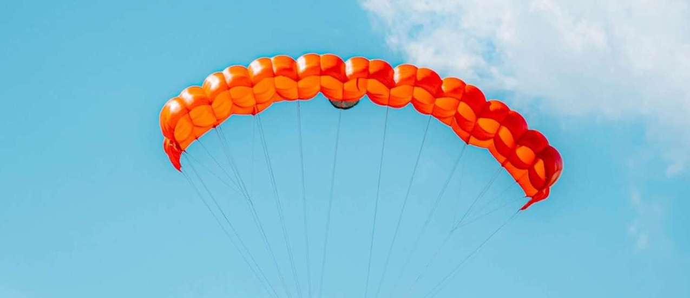

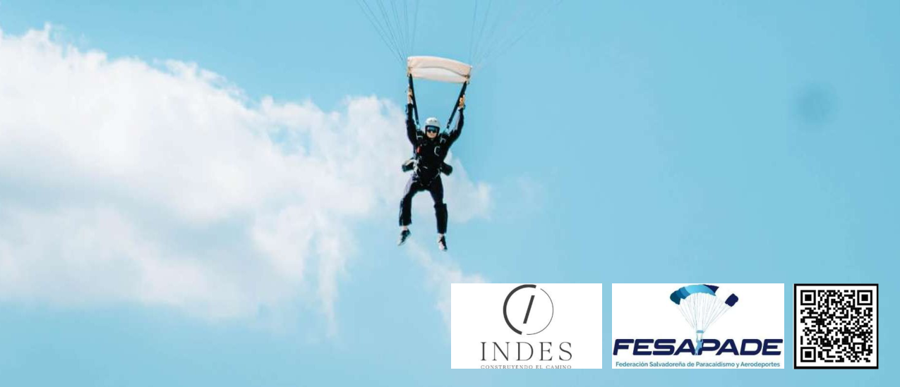

---

<!-- Página 2 del PDF -->

## ¡ATENCIÓN!
El paracaidismo es un deporte de alto riesgo que puede resultar en lesiones graves o en fatalidades. Para reducir estos riesgos, es necesario recibir instrucción y entrenamiento con profesionales calificados y certificados por alguna Federación o Asociación Oficial de este deporte.

CURSO DE PARACAIDISMO: MANUAL DEL ALUMNO

Autor: Edy L. T. Montalvan

Todos los derechos reservados.

**Primera edición** . 2025.

Montalvan, E.L.T. (2024). **Curso de Paracaidismo: Manual del Alumno** . Federación Salvadoreña de Paracaidismo – FESAPADE. 1ª. Ed., 76 páginas. San Salvador Centro, San Salvador, El Salvador.

---

<!-- Página 3 del PDF -->

## PROLOGO

Es un honor para mí, como presidente de la **Federación Salvadoreña de Paracaidismo (FESAPADE)** , presentar la primera edición del **Manual del Curso de Paracaidismo Básico** . Este documento no solo marca un hito en la historia de nuestra federación, sino que también representa un compromiso inquebrantable con la excelencia, la seguridad y el desarrollo del paracaidismo en El Salvador.

El paracaidismo es una disciplina que combina adrenalina, precisión y un profundo respeto por los protocolos de seguridad. Cada salto es una experiencia única, pero también conlleva riesgos que deben ser gestionados con responsabilidad y conocimiento. Este manual nace con el propósito de ser una guía integral para todos aquellos que deseen adentrarse en el mundo del paracaidismo, ofreciendo las herramientas necesarias para formar atletas competentes, conscientes y, sobre todo, seguros.

En estas páginas, los instructores, estudiantes y entusiastas del paracaidismo encontrarán un compendio de técnicas, procedimientos y recomendaciones basadas en estándares internacionales y en la experiencia acumulada por nuestros profesionales. Hemos puesto especial énfasis en la seguridad, ya que es nuestro deber garantizar que cada salto sea una experiencia memorable, pero también libre de incidentes. La vida de nuestros atletas es nuestro bien más preciado, y este manual es un reflejo de ese compromiso.

Quiero aprovechar este espacio para reconocer el esfuerzo y dedicación de todos aquellos que han contribuido a la creación de este manual. Su pasión por este deporte y su compromiso con la excelencia han hecho posible que hoy podamos compartir este valioso recurso con la comunidad de paracaidismo. En especial, extiendo mi más sincero agradecimiento a:

- **Los instructores y técnicos de FESAPADE** , cuyo conocimiento y experiencia han sido fundamentales para estructurar el contenido técnico de este manual.

- **Los atletas paracaidistas** , quienes con su pasión y disciplina han inspirado la creación de un documento que busca proteger y guiar a las futuras generaciones.

---

<!-- Página 4 del PDF -->

- **El equipo editorial y de diseño** , por su dedicación en la organización, redacción y presentación de este material, asegurando que sea claro, accesible y visualmente atractivo.

Este manual no es solo un documento técnico; es un legado que dejamos a las futuras generaciones de paracaidistas. Además, es una invitación a seguir creciendo, aprendiendo y, sobre todo, a practicar este deporte con responsabilidad.

Que esta primera edición sea el inicio de una nueva era para el paracaidismo en nuestro país, donde la seguridad y la profesionalización sean los pilares que nos guíen hacia nuevos horizontes.

Con gratitud y orgullo,

**Marlon Adonay Henríquez Parada**

Presidente de la Federación Salvadoreña de Paracaidismo (FESAPADE)

Periodo 2025 – 2029

Distrito de Ilopango, San Salvador Este, San Salvador, El Salvador.

_Junta Directiva de_ la Federación Salvadoreña de Paracaidismo (FESAPADE) Periodo 2025 – 2029

|Marlon Adonay Henríquez Parada|Presidente|
|---|---|
|Carlos Sebastian Tejada Aldana|Vicepresidente|
|Demar Gustavo Ruiz Melara|Tesorero|
|Alex Jeovani Quintanilla Diaz|Secretario|
|Ricardo Alejandro Sandoval Arevalo|Vocal 1|
|Diego Gerardo Martínez Leiva|Vocal 2|
|Felix Armando Perez Guadron|Vocal 2|
|Joseline Alejandra Gómez Gómez|Gerente administrativo|

---

<!-- Página 5 del PDF -->

## CONTENIDO
### MÓDULO I:

|1. BREVE HISTÓRIA DEL PARACAIDISMO ...................................................................... 9|
|---|
|2. TIPOS DE INSTRUCCIÓN .............................................................................................. 14|
|3. EQUIPAMIENTO ............................................................................................................ 15|
|Paracaidas ............................................................................................................................ 15|
|Accesórios ............................................................................................................................ 22|
|MÓDULO II:|
|4. AERONAVE ..................................................................................................................... 25|
|APROXIMACIÓN Y ABORDAJE ........................................................................................ 25|
|ASCENSO ............................................................................................................................. 25|
|SPOTTING ........................................................................................................................... 25|
|5. SALIDA DE LA AERONAVE .......................................................................................... 29|
|6. CAIDA LIBRE .................................................................................................................. 30|
|VELOCIDAD DE CAIDA ..................................................................................................... 30|
|POSICIÓN DEL CUERPO ................................................................................................... 31|
|MÓDULO III:|
|7. APERTURA DEL PARACAIDAS ..................................................................................... 34|
|REVISIONES / CHECKS ...................................................................................................... 34|
|8. PROCEDIMIENTO DE EMERGENCIA .......................................................................... 37|
|9. ANORMALIDADES .........................................................................................................42|
|1. DE ALTA VELOCIDAD ...............................................................................................42|
|2. DE BAJA VELOCIDAD ............................................................................................... 44|
|MÓDULO IV:|
|10. NAVEGACIÓN Y ATERRIZAJE ................................................................................... 57|
|Navegación .......................................................................................................................... 57|
|Aterrizaje............................................................................................................................. 60|

---

<!-- Página 6 del PDF -->

|11. PROGRESIÓN EN EL DEPORTE ................................................................................... 66|
|---|
|BUENAS PRÁCTICAS PARA PROGRESAR CON SEGURIDAD EN EL DEPORTE ......... 66|
|¿CÓMO SELECCIONAR EL TAMAÑO ADECUADO DE TU CÚPULA? ........................ 69|
|CATEGORIAS - LICENCIAS USPA .....................................................................................70|
|Otras Certificaciones y Especialidades ............................................................................... 72|
|12. GLOSARIO DE TÉRMINOS Y SIGLAS ....................................................................... 74|
|RECURSOS ADICIONALES.................................................................................................... 75|

---

<!-- Página 7 del PDF -->

## LISTA DE ILUSTRACIONES
|**Ilustración 1**- Primordios del estilo Freeflying. Fuente: The Skydiver’s Handbook. ........ 10 **Ilustración 2**- Primordios de la modalidad Trabajo Relativo (_relative work_) en la década de 1970. Fuente:_The Skydiver’s Handbook_. ............................................................................. 11|
|---|
|**Ilustración 3**– Salto de paracaídas modalidad tándem en la década de 1980. Fuente: The Skydiver’s Handbook.3............................................................................................................ 12|
|**Ilustración 4**- Álbum de fotografías del_FAI World Air Games Dubai 2015_. Fuente: FAI ... 13|
|**Ilustración 5 –**Vista trasera de un contenedor utilizado en saltos con línea estática. Fuente: autor......................................................................................................................................... 15|
|**Ilustración 6 –**Partes del contenedor y arnés de un equipo de paracaídas. Fuente: modificado de The Skydiver’s Handbook. ............................................................................. 16|
|**Ilustración 7**- Sistema 3-anillos: a) Sistema convencional; b) Sistema del fabricante Aerodyne; c) 3-anillos con desgaste por uso (aprox. mil saltos). ......................................... 17|
|**Ilustración 8**- Línea de Liberación Estática - RSL (Release Static Line. Fuente: Modificado de www.dropzone.com). ......................................................................................................... 18|
|**Ilustración 9**- Pines en el contenedor del equipo:**pin del principal**. Fuente: Modificado de www.dropzone.com). ......................................................................................................... 18|
|**Ilustración 10**- Pines en el contenedor del equipo:**pin de la reserva**. Fuente: Modificado de www.dropzone.com). ......................................................................................................... 19|
|**Ilustración 11 –**Partes de un paracaídas (descripción general). Fuente: cortesía FESAPAFE. .................................................................................................................................................20|
|**Ilustración 12 –**Dispositivo de Apertura Automática (AAD). Fuente: Vigil Quatro. ........ 21|
|**Ilustración 13 –**Altímetros: a) analógico; b) electrónico; c) digital. ................................... 23|
|**Ilustración 14 -**Maestro de salto haciendo spotting. Fuente: cortesía FESAPADE. ......... 26|
|**Ilustración 15**– Salida de la aeronave: saltos 1 y 2 del curso. Fuente: cortesía. FESAPADE. ................................................................................................................................................ 29|
|**Ilustración 16**– Velocidades en caída libre. Fuente: elaboración propia. .......................... 31|
|**Ilustración 17 -**Posición ideal del cuerpo en caída libre (“box position” o “rana”). Fuente: modificado de Body Flying (1979). ......................................................................................... 32|
|**Ilustración 18 -**Cúpula abierta completamente. Check visual: OK. ................................... 36|

---

<!-- Página 8 del PDF -->

|**Ilustración 19**– Proceso de liberación de la cúpula de reserva. Fuente: archivo personal. ................................................................................................................................................. 37|
|---|
|**Ilustración 20**– Procedimiento de emergencia: a) una mano cada gancho. ..................... 39|
|**Ilustración 21**– Procedimiento de emergencia: a) una mano cada gancho. ...................... 41|
|**Ilustración 22**– Anormalidad tipo “_bag-lock_”. Fuente:_Performance Designs_. ..................42|
|**Ilustración 23**- Anormalidad tipo "line twist" de alta velocidad. Fuente: Performance|
|Designs. ................................................................................................................................... 43|
|**Ilustración 24**- Anormalidad: tela rasgada. Fuente: Performance Designs. ..................... 44|
|**Ilustración 25**- Anormalidad: "line twist". Fuente: Performance Designs. ........................ 45|
|**Ilustración 26**- Anormalidad: "line-over". Performance Designs. ..................................... 47|
|**Ilustración 27**- Anormalidad: combinada (en la ilustración hay 3 anormalidades combinadas). Performance Designs. ..................................................................................... 48|
|**Ilustración 28**- Anormalidad: biplano. Performance Designs. ......................................... 49|
|**Ilustración 29**- Anormalidad: lado-a-lado (_side-by-side)_._Performance Designs_. .............. 50|
|**Ilustración 30**- Anormalidad:_downplane_._Performance Designs_. ...................................... 51|
|**Ilustración 31**- Anormalidad: entrelazados (_entanglement_)._Performance Designs_. ......... 52|
|**Ilustración 32**– Pilotín por debajo de la cúpula._Performance Designs_. ............................ 53|
|**Ilustración 33**– Líneas enredadas._Performance Designs_. ................................................... 54|
|**Ilustración 34**– Una o varias líneas reventadas._Performance Designs_. ............................. 55|
|**Ilustración 35**– Concepto del Cono de Maniobrabilidad y navegación. Fuente: modificado|
|de The Skydiver’s Handbook. ................................................................................................. 58|
|**Ilustración 36**– Concepto del Cono de Viento para condiciones con y sin viento. Fuente: modificado de The Skydiver’s Handbook. .............................................................................59|
|**lustración 37**– Patrón de aterrizaje. Fuente: USPA (2022). ................................................ 61|
|**Ilustración 38**– Patrón de aterrizaje. Fuente: skydivingtraining.org (2025). ................... 62|
|**Ilustración 39**– Procedimiento para realizar PFL. Fuente: skydivetraining.org (2025). ... 64|

---

<!-- Página 9 del PDF -->

## MÓDULO I

---

<!-- Página 10 del PDF -->

### 1. BREVE HISTÓRIA DEL PARACAIDISMO

A continuación, se presenta una breve historia de la evolución del deporte de paracaidismo, abarcando desde su génesis hasta la época actual, preparada por Max Kuch (2024)1 y mejorada por el autor agregando fotografías y otros datos relevantes:

#### 1797
El francés André-Jacques Garnerin realizó el primer salto de paracaidismo oficialmente registrado, estableciendo de esta manera los orígenes del paracaidismo. En lugar de descenso libre, Garnerin subió en un balón de aire caliente y saltó desde una altura aproximada de 3,200 pies (975 m) con un paracaídas de seda (con frecuencia escucharás que los paracaidistas se llaman entre sí “Hermanos de la Seda”). Esta hazaña marcó el inicio de una nueva era en el diseño y mejoramiento de los equipos de paracaidismo.

#### 1911-1914
A inicios del siglo 20, inventores como Grant Morton y Charles Broadwick mejoraron enormemente la tecnología de los paracaídas. En 1911, Morton notablemente saltó desde una aeronave usando un paracaídas de su propia invención, mientras que en 1914 Broadwick mostró su nueva invención: un paracaídas con un arnés de liberación rápida. Sus diseños innovadores avanzaron el deporte de paracaidismo significativamente.

#### 1930s
Durante la década del 1930, los militares comenzaron a establecer unidades dedicados a paracaidismo. En 1931, la empresa alemana Luftwaff creó el primer paracaídas para la fuerza aérea, y los soviéticos pronto siguieron la misma dirección en 1935. La formación de estas unidades marcó el inicio de una próspera cultura del paracaidismo militar que nos condujo al crecimiento de este deporte.

#### 1937
El paracaidista ruso Mikhail Gushchin alcanzó un hito al completar 101 saltos en mismo día. El establecimiento de este récord demostró el potencial del paracaidismo y atrajo la

> 1 Disponible en: _<u>https://sportsfoundation.org/skydiving-history/. Último acceso: 28/07/2024</u>_

---

<!-- Página 11 del PDF -->

atención de muchos a este nuevo deporte. La emisión transmitida por el logro de Gushchin propulsó el deporte a un amplio reconocimiento.

#### 1950s-1960s
En la pós-guerra de la II Guerra Mundial, el deporte del paracaidismo creció en popularidad. En 1951, las primeras escuelas de paracaidismo deportivo fueron abiertas en Francia, diseminándose gradualmente hacia Europa y los Estados Unidos. La fundación del Club de Paracaidismo de América ( _The Parachute Club of America_ ) en 1956, hoy en día es la Asociación de Paracaidismo de los Estados Unidos (USPA, por sus siglas en inglés _United States Parachute Association_ ), dio legitimidad una vez más al deporte.

El paracaidismo competitivo se desarrolló en este periodo. El primer Campeonato Mundial de Paracaidismo fue celebrado en Yugoslavia en 1951. En 1960, el paracaidista americano Dan Sanborn estableció un nuevo récord al realizar el salto de descenso libre más alto de la historia a saltar desde una altura de 25,150 pies (7,667.7 m), un logro espectacular que empujó los límites de “lo que era posible en el deporte”.

#### 1970s
En la década del 70 se presenció el advenimiento de nuevas y emocionantes disciplinas del paracaidismo. El _Freeflying_ , una modalidad que envuelve una serie de posiciones del cuerpo ( _body positions_ ) y orientaciones, surgió a inicios de 1970 (ver Ilustración 1).

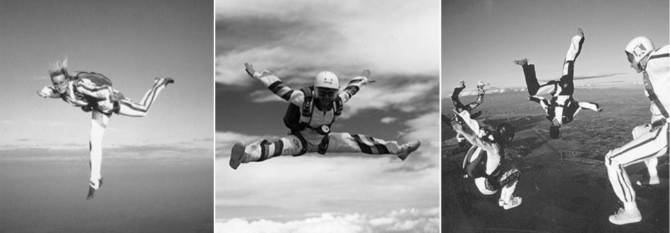

**Ilustración 1** - Primordios del estilo Freeflying. Fuente: The Skydiver’s Handbook.2

> 2 Poynter, D.; Turoff, M. (2003). The Skydiver’s Handbook. Para Publishing, 402 pp.

---

<!-- Página 12 del PDF -->

La evolución del deporte continuó con la introducción de la modalidad de Trabajo Relativo ( _relative work_ ) o Formación – una disciplina donde los deportistas hacen formaciones durante el descenso en caída libre (ver **Ilustración 2** ).

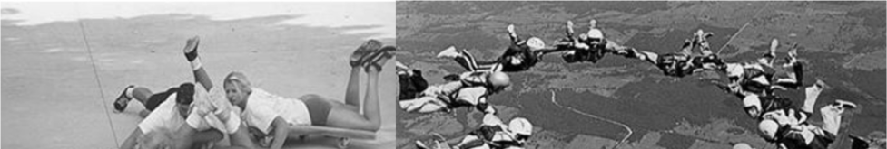

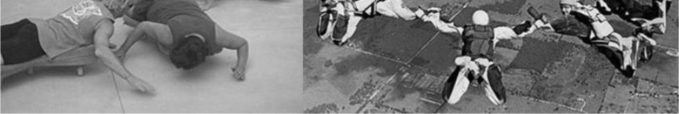

**Ilustración 2** - Primordios de la modalidad Trabajo Relativo ( _relative work_ ) en la década de 1970. Fuente: _The Skydiver’s Handbook_ .3

#### 1980s
La seguridad en el paracaidismo pasó por una fase de grandes mejorías durante la década del 80. Los Dispositivos de Apertura Automática (AAD) fueron adoptados ampliamente, reduciendo enormemente el riesgo de accidentes durante la apertura del paracaídas. En 1984 se introdujo la modalidad de paracaidismo tándem, el cual permitió que personas inexpertas experimentaran el deporte, haciéndolo más accesible a público ( **Ilustración 3** ).

> 3 Ídem

---

<!-- Página 13 del PDF -->

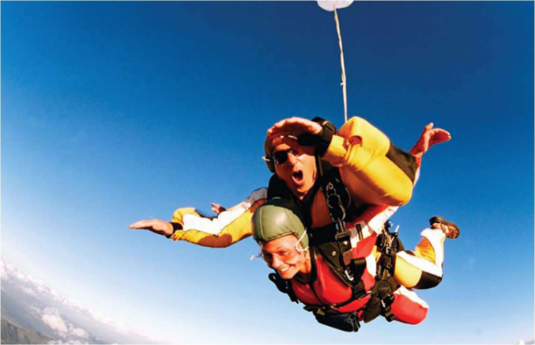

**Ilustración 3** – Salto de paracaídas modalidad tándem en la década de 1980. Fuente: The Skydiver’s Handbook.3

#### 1990s y 2000s
En las décadas de 1990 y 2000, con los adelantos en la tecnología de los equipos de paracaidismo, emergieron nuevas disciplinas como el _swooping_ (aterrizajes de alto nivel o desempeño) y vuelos _wingsuit._ El deporte mantuvo un crecimiento exponencial, atrayendo más que nunca a participantes y entusiastas.

La cobertura de los medios de comunicación en los eventos de paracaidismo, como los Juegos Mundiales del Aire celebrados en Turquía en 1997, elevaron el perfil del deporte a nivel global. Desde entonces, los Juegos Mundiales del Aire han sido celebrados en España (2001), Italia (2009) y Dubái, UAE (2015).

---

<!-- Página 14 del PDF -->

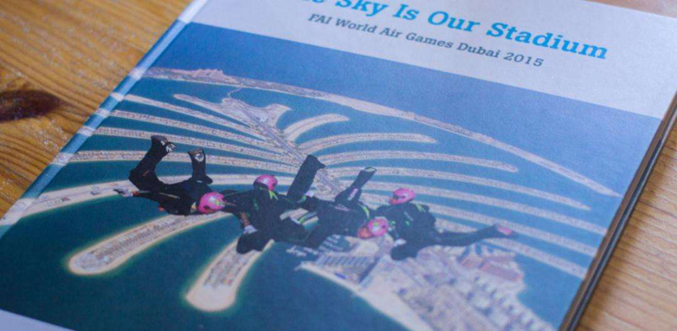

**Ilustración 4** - Álbum de fotografías del _FAI World Air Games Dubai 2015_ . Fuente: FAI4

Hoy en día la práctica del deporte de paracaidismo es extremadamente segura, los fabricantes continúan mejorando los equipos y accesorios utilizados en el deporte. Las estadísticas del Resumen Anual de Fatalidades publicado por la revista _Parachutist_5 muestran que, en 2023 se obtuvo un índice de fatalidad de 0.27 fatalidades por cada 100,000 saltos realizados en los Estados Unidos. Este valor es 40 veces menor que el índice de fatalidad de 1961, el cual fue de 11 fatalidades por cada 100,000 saltos. Actualmente, se registra que el número de saltos al año es de alrededor de 3.65 millones de saltos.

- 4 Disponible en: <u>https://www.fai.org/news/photo-book-fai-world-air-games-2015-nowavailable. Último acceso: 28/07/2024</u>

- 5 Disponible en: <u>https://parachutist.com/Article/a-widespread-improvementthe-2023fatality-summary. Último acceso: 01/07/2024</u>

---

<!-- Página 15 del PDF -->

### 2. TIPOS DE INSTRUCCIÓN

El entrenamiento para iniciar a practicar el paracaidismo suele clasificarse en 3 modalidades: tándem, apertura asistida o con línea estática y AFF.

#### TANDEM
De las tres modalidades de instrucción, tándem es la más sencilla, debido a que requiere únicamente una revisión rápida. Esta modalidad consiste en un salto realizado junto a instructor, el cual sujeta al “pasajero” en su pecho mediante conexión a su arnés. Esta modalidad esta más dirigida hacia el público general. Los entusiastas que desean progresar en el deporte deber realizar un curso de instrucción tipo AFF, Apertura Asistida o Apertura con Línea Estática.

#### Apertura asistida o con Línea Estática
La modalidad tradicional de instrucción para primer salto de paracaídas ha sido con apertura por línea estática. Según las estadísticas, esta modalidad abarca un 24% de primer salto de los paracaidistas, sin embargo, en los años recientes la modalidad de AFF ha continuado aumentando en su uso.

El salto con apertura asistida consiste en un salto solo desde una altura de 3,500 a 5,000 pies, en donde la apertura de tu paracaídas es asistida por el instructor. Una vez que la cúpula del paracaídas se encuentra abierta, el paracaidista vuela hacia la zona de aterrizaje. El paracaidista debe completar un total de cuatro (4) saltos: 2 asistidos y dos (2) de caída libre en los cuales deberá realizar la apertura de su paracaídas.

Esta modalidad de instrucción es la que se cubre en el presente manual CURSO DE PARACAIDISMO.

#### AFF
La modalidad Descenso Libre Acelerado ( _Accelerated Free Fall_ – AFF), consiste en un salto realizado desde una altura de 9,000 pies o más, con el objetivo de lograr no menos de 30 segundos de caída libre. Dos instructores certificados acompañan al estudiante, sosteniéndolo uno de cada lado, durante la salida de la aeronave y la caída libre. En esta modalidad, el alumno debe realizar la apertura de su equipo, y una vez abierto el paracaídas debe navegar hacia la zona y aterrizar. El curso AFF exige que el estudiante cumpla con un objetivo en cada uno de los siete saltos (7) que se deben realizar, por lo tanto, el estudiante necesita de mayor entrenamiento para los procedimientos de salida, caída libre, y apertura de equipo.

---

<!-- Página 16 del PDF -->

### 3. EQUIPAMIENTO

#### PARACAIDAS

El equipo de paracaidismo está compuesto por 4 parte principales:

1. Arnés/contenedor

2. Cúpula principal

3. Cúpula reserva

4. Dispositivo de Apertura Automática (AAD)

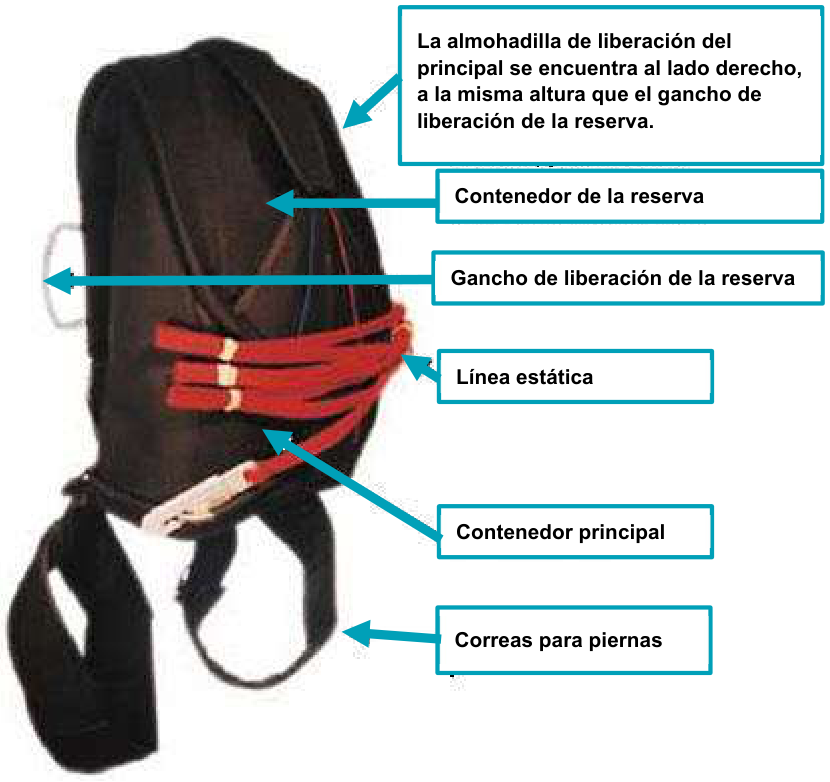

<!-- Start of picture text -->
La almohadilla de liberación del principal se encuentra al lado derecho, a la misma altura que el gancho de liberación de la reserva. Contenedor de la reserva Gancho de liberación de la reserva Línea estática Contenedor principal Correas para piernas <!-- End of picture text -->

**Ilustración 5 –** Vista trasera de un contenedor utilizado en saltos con línea estática. Fuente: autor.

---

<!-- Página 17 del PDF -->

<!-- Start of picture text -->
VISTA FRONTAL <!-- End of picture text -->

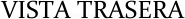

<!-- Start of picture text -->
VISTA TRASERA <!-- End of picture text -->

- **Ilustración 6 –** Partes del contenedor y arnés de un equipo de paracaídas. Fuente: modificado de The Skydiver’s Handbook.6

El arnés o contenedor del equipo cuenta con una serie de componentes de gran importancia para su adecuado funcionamiento. Entre ellos:

   - a) Almohadilla de liberación del principal ( **Ilustración 6** ).

   - b) Gancho o almohadilla de la reserva ( **Ilustración 6** ).

   - c) Sistema de liberación 3-anillos ( _3-ring system_ ), desarrollado y patentado por el Americano Bill Booth en la década de 1970 ( **Ilustración 7** ).

- 6 Poynter, D.; Turoff, M. (2003). The Skydiver’s Handbook. Para Publishing, 402 pp., ISBN: 9781568600871.

---

<!-- Página 18 del PDF -->

- d) RSL o sistema Stevens, este componente sirva como línea estática para auxiliar en la apertura de la reserva en situaciones de emergencia en la que la cúpula principal es liberada ( **Ilustración 8** ).

- e) Pin del principal ( **Ilustración 9** ).

- f) Pin de la reserva (Ilustración 10).

- g) Cúpula (Ilustración 11)

- h) AAD = dispositivo de apertura automática ( **Ilustración 12** )

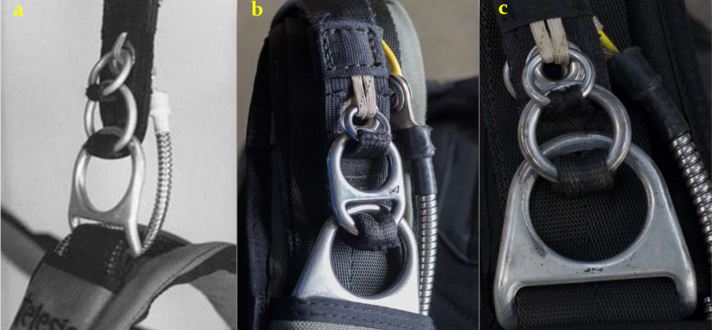

<!-- Start of picture text -->
a  b  c <!-- End of picture text -->

**_Ilustración 7_** _- Sistema 3-anillos: a) Sistema convencional; b) Sistema del fabricante Aerodyne; c) 3-anillos con desgaste por uso (aprox. mil saltos)._

Todo paracaidista es responsable de realizar tres verificaciones antes de cada salto:

- 1) Antes de equiparse.

- 2) Antes de abordar.

- 3) Antes de salir del avión.

---

<!-- Página 19 del PDF -->

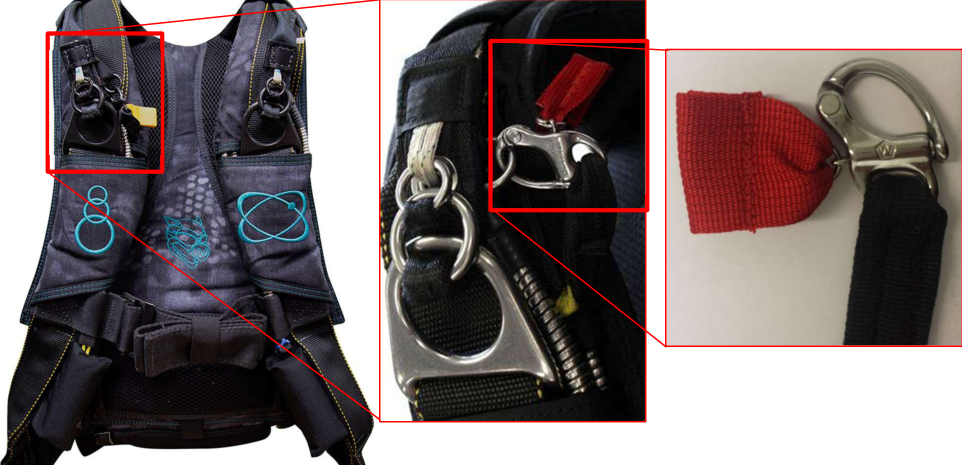

**_Ilustración 8_** _- Línea de Liberación Estática - RSL (Release Static Line. Fuente: Modificado de www.dropzone.com)._

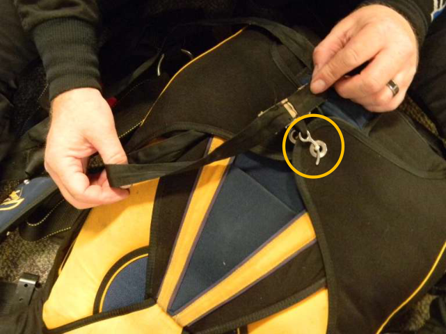

**Ilustración 9** - Pines en el contenedor del equipo: **pin del principal** . Fuente: Modificado de www.dropzone.com).

---

<!-- Página 20 del PDF -->

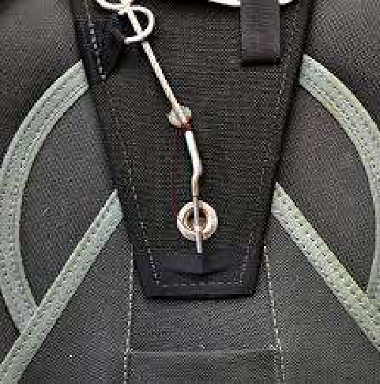

**Ilustración 10** - Pines en el contenedor del equipo: **pin de la reserva** . Fuente: Modificado de www.dropzone.com).

---

<!-- Página 21 del PDF -->

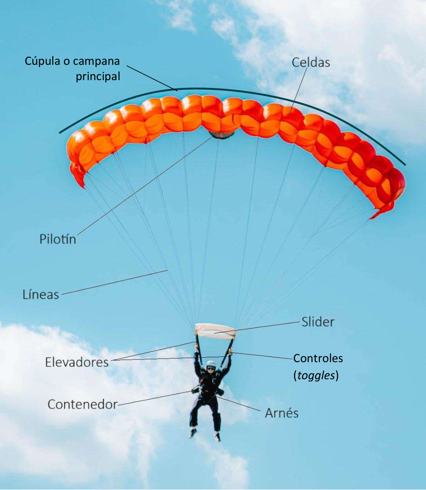

<!-- Start of picture text -->
Cúpula o campana principal Controles ( toggles ) <!-- End of picture text -->

**Ilustración 11 –** Partes de un paracaídas (descripción general). Fuente: cortesía FESAPAFE.

---

<!-- Página 22 del PDF -->

El Dispositivo de Activación Automática (AAD, por sus siglas en inglés _Automatic Activation Device_ ) es un sistema de seguridad electrónico utilizado para desplegar automáticamente el paracaídas de reserva. Este dispositivo ha sido diseñado para emergencias (como pérdida de conciencia o desorientación), actúa como un "último recurso" para garantizar la supervivencia. Los modelos más comunes en el mercado ( _CYPRES_ o _Vigil_ ) miden altitud y velocidad mediante sensores, activándose solo si se cumplen condiciones de peligro preprogramadas. El AAD está compuesto por un microcomputador con algoritmos que analiza datos en tiempo real. Al detectar una velocidad vertical excesiva (por ejemplo, >35 m/s) y una altitud inferior a un umbral seguro (entre 750 y 1,500 pies), el AAD activa una guillotina que corta la línea ( _closing loop)_ del contenedor de la reserva, iniciando su secuencia de despliegue. Su precisión ha salvado la vida de cientos de atletas, siendo hoy obligatorio en muchas _dropzones_ . Los principales componentes de un AAD son mostrados en la Ilustración 12.

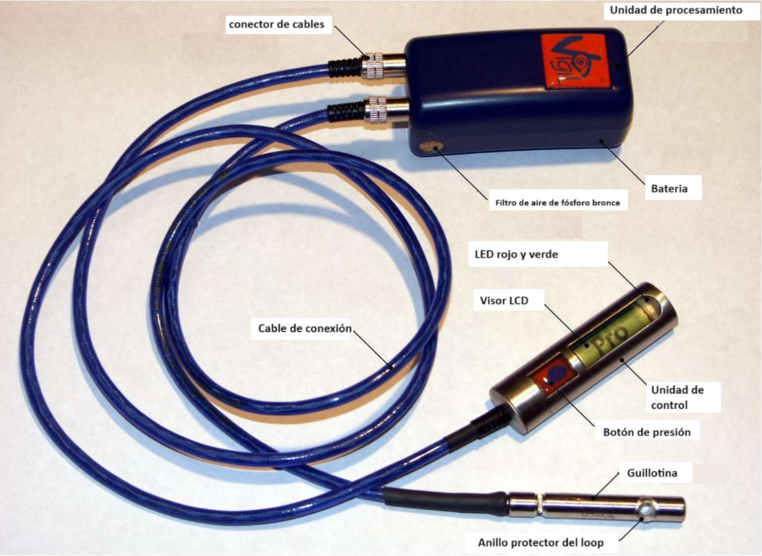

**Ilustración 12 –** Dispositivo de Apertura Automática (AAD). Fuente: Vigil Quatro.7

> 7 Disponible en: https://www.vigil.aero/manuals. Último acceso: 01/08/2024

---

<!-- Página 23 del PDF -->

#### ACCESÓRIOS

1. Casco

2. Altímetro

3. Gabacha

4. Radio

5. Lentes

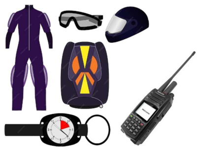

#### Uso de altímetros
Los paracaidistas siempre deben saber la altura. **¡CONCIENCIA DE LA ALTURA!**

Hay una perdida significativa de percepción de profundidad sobre el agua o en la noche. La altura de apertura y otras alturas criticas pueden ser determinadas por el uso de referencias en tierra y el altímetro. Como referencia primaria cada paracaidista debería aprender a determinar las alturas criticas (separación, apertura y liberación) mirando al piso y llevando un conteo de tiempo en caída libre. Los altímetros son una excelente referencia secundaria para desarrollar y verificar las habilidades primarias de reconocimiento de altura. Existen altímetros visuales (ilustración 13) y audibles.

#### Errores del altímetro:
Los altímetros utilizan componentes electrónicos y mecánicos sujetos a daños por uso. Se pueden esperar diferencias mínimas de altura entre altímetros. Tomar cuidado con las siguientes indicaciones:

- Configure el altímetro en la zona de aterrizaje y no lo reajuste después de despegar.

- Los altímetros pueden tener variaciones de **+/- 500 pies** durante el ascenso o la caída.

- Las agujas se pueden trabar durante el ascenso o el descenso, se deben tener referencias visuales en tierra en combinación con el altímetro.

- Cuando el altímetro contiene una burbuja puede tener una diferencia de hasta 1.000 pies.

- Maneje los altímetros con cuidado, manténgalos y guárdelos de acuerdo con las recomendaciones del fabricante.

---

<!-- Página 24 del PDF -->

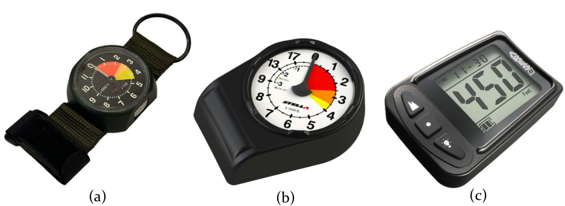

<!-- Start of picture text -->
(a)  (b)  (c) <!-- End of picture text -->

**Ilustración 13 –** Altímetros: a) analógico; b) electrónico; c) digital.

---

<!-- Página 25 del PDF -->

## MÓDULO II
---

<!-- Página 26 del PDF -->

### 4. AERONAVE

APROXIMACIÓN Y ABORDAJE

- a) Nunca aproximarse por el frente de la aeronave. Para el abordaje siempre aproximarse por la parte trasera de la aeronave.

- b) Antes del abordaje, se debe realizar un segundo check del equipo.

- c) Revisar el patrón de viento y repasar el plan de navegación y aterrizaje

- d) El alumno debe proteger la almohadilla de liberación del principal y gancho de la reserva.

- e) El alumno debe proteger los pines del principal y de la reserva en todo momento que esté dentro del aeronave.

#### ASCENSO

Durante el ascenso de la aeronave, recordar las alturas críticas y los procedimientos a seguir en caso de emergencia por falla de la aeronave:

- a) 0-1,500 ft: baja altura. Posición de impacto, rodillas dobladas, cabeza entre ellas y manos en la nuca

- b) 1,500-3,000 ft: salida de clavado, con ambas manos en el gancho de la reserva y accionarlo cuando este fuera de la aeronave.

- c) 3,000-4,500 ft: salida de clavado y abrir el paracaídas principal inmediatamente a la salida de la aeronave.

- d) Arriba de 4,500 ft: salida anticipada con orientación del maestro de salto.

- e) En caso de fuego o falla estructural de la aeronave, salir inmediatamente.

- f) Si el pilotín del equipo de un paracaidista llegase a salirse y caer dentro de la aeronave, recoger todo y apartarse de la puerta o irse al fondo de la aeronave. Apagar el dispositivo de activación automática. El paracaidista debe aterrizar con la aeronave.

#### SPOTTING

El "spotting" en paracaidismo es el proceso crítico de seleccionar y determinar el punto exacto de salida desde el avión para garantizar que los paracaidistas aterricen de manera segura en la zona de aterrizaje designada (ver **Ilustración 14** ). Consiste en calcular y ajustar factores variables en tiempo real para minimizar riesgos y maximizar la precisión.

- **Cálculo del Punto de Salida (** **_Exit Point_ ):** Se determina antes del salto, considerando los siguientes aspectos:

- a) Altitud de salida (por ejemplo, entre 6,000 a 12,000 pies).

- b) Velocidad y dirección del viento (en superficie y altitud).

- c) Velocidad y rumbo del avión.

---

<!-- Página 27 del PDF -->

- d) Tipo de salto ( _freefall, canopy piloting,_ formación en grupo, _wingsuit_ ).

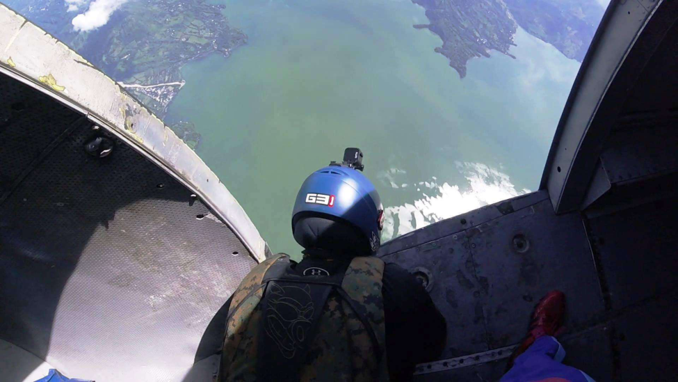

**Ilustración 14 -** Maestro de salto haciendo spotting. Fuente: cortesía FESAPADE.

#### Factores Ajustables Durante el Vuelo:
- e) Deriva del avión: El piloto o spotter (persona encargada) puede modificar la ruta si el viento cambia.

- f) Nubes u obstáculos: Se evitan zonas con nubes densas o terreno peligroso.

- g) Tráfico aéreo: En zonas con múltiples aviones, se coordina para evitar colisiones.

#### Técnicas de Compensación:
- h) Ángulo de deriva ( _drift_ ): Se corrige el punto de salida para que los paracaidistas "floten" con el viento y no se alejen de la zona de aterrizaje.

- i) "Puntos de referencia visuales": Montañas, ríos o carreteras ayudan al spotter a orientarse.

---

<!-- Página 28 del PDF -->

#### Comunicación en Tiempo Real:
- j) El spotter usa radios o señales manuales para coordinar con el piloto y los paracaidistas.

- k) En saltos en grupo, se prioriza el orden de salida para evitar colisiones en el aire. Orden de salida: _sky gods_ , paracaidistas con mayor carga alar ( _wing load_ ), alumnos con _coach_ , alumnos con línea, tándem.

La **carga alar** es la proporción del peso del paracaidista equipado dividido por los pies cuadrados de la cúpula. La fórmula para el cálculo de la carga alar es la siguiente:

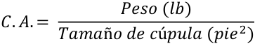

C. A. = Peso (lb) / Tamaño de cúpula (pie²)

Un paracaidista, cuyo peso es de 150 lb ya equipado (peso del equipamiento varía entre 20 a 25 lb), con una cúpula tamaño 170 (170 pie2 ) tiene la siguiente carga alar:

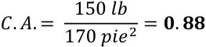

C. A. = 150 lb / 170 pie² = **0.88**

En general, se recomienda que los paracaidistas novatos y menos experimentados NUNCA tengan una carga alar mayor que **1.0** .

#### Tipos de Spotting Según el Salto:
- l) Saltos de Precisión ( _Canopy Piloting_ ): El _spotting_ es ultra-exacto para aterrizar en un blanco pequeño.

- m) Saltos en Formación: Se ajusta para que el grupo abra los paracaídas cerca y pueda aterrizar junto.

- n) _Wingsuiting_ : Requiere cálculos más complejos por la distancia horizontal que se recorre.

#### Consecuencias de un Mal Spotting:
- o) Aterrizar fuera de la zona designada (ej. en árboles, carreteras o agua).

- p) Separación peligrosa entre paracaidistas en el aire.

- q) Mayor tiempo de vuelo bajo el paracaídas, agotando recursos o exponiéndose a cambios climáticos.

---

<!-- Página 29 del PDF -->

#### ¿Quién hace el Spotting?
- r) Spotter designado: Paracaidista experimentado, instructor o maestro de salto. Sin embargo, cada paracaidista es RESPONSABLE de hacer

- s) Piloto del avión: En saltos sencillos, puede asumir el rol.

- t) Sistemas electrónicos: Algunos aviones usan GPS y software para asistir.

**El spotting es una combinación de ciencia (física y meteorología) y experiencia práctica, esencial para la seguridad en este deporte extremo.** 🪂

---

<!-- Página 30 del PDF -->

### 5. SALIDA DE LA AERONAVE

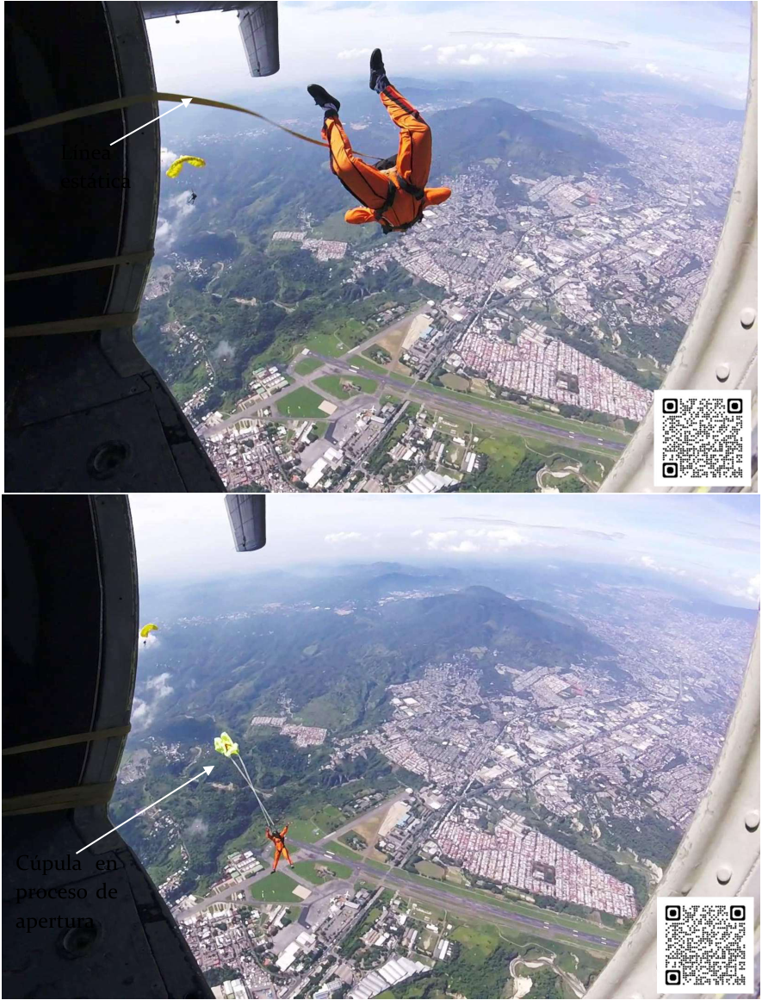

<!-- Start of picture text -->
Línea estática Cúpula en proceso de apertura <!-- End of picture text -->

**Ilustración 15** – Salida de la aeronave: saltos 1 y 2 del curso. Fuente: cortesía. FESAPADE.

---

<!-- Página 31 del PDF -->

En este curso de paracaidismo básico, el alumno realiza sus primeros dos saltos (2) con apertura asistida, es decir, que le paracaídas se abrirá automáticamente una vez que el alumno haya saltado fuera de la aeronave (Ilustración 15). En los siguientes dos saltos, el alumno deberá abrir su paracaídas.

Recomendaciones para el alumno:

- Al salir del avión, manténgase arqueado estable y con los hombros a nivel durante el despliegue, contando hasta cinco por miles.

- Mire por encima de su hombro para ver el pilotín (si se usa) y el despliegue del paracaídas principal.

### 6. CAIDA LIBRE

A partir del tercer salto, el alumno comienza a realizar la apertura de su paracaídas. Por esta razón, el alumno debe saber cómo saltar de la aeronave de manera estable y como estabilizar en caída libre para garantizar una apertura suave y segura del paracaídas.

#### VELOCIDAD DE CAIDA

Cuando un paracaidista salta de un avión, que viaja a una velocidad horizontal de alrededor de 130 km/h, inicialmente mantiene ese impulso hacia adelante ( _movimiento parabólico,_ ver Ilustración 16). Sin embargo, la resistencia del aire frena gradualmente la velocidad horizontal, mientras la gravedad lo acelera verticalmente hasta alcanzar la velocidad terminal (máxima velocidad vertical en caída libre). La velocidad terminal de un paracaidista en caída libre es de aproximadamente 200 km/h.

Esto crea una trayectoria curva (en forma de arco):

Fase inicial (tras el salto): Predomina el avance horizontal (130 km/h), con poca caída vertical.

Fase media: El cuerpo se inclina y la resistencia del aire reduce la velocidad horizontal, mientras la vertical aumenta.

Fase terminal: El paracaidista cae casi verticalmente (200 km/h) con mínima velocidad horizontal.

Resultado el resultado es un arco suave que combina la inercia del avión y la aceleración gravitatoria, hasta estabilizarse en caída vertical pura.

Los paracaidistas caen 1.000 pies durante los primeros 10 segundos y después 1.000 pies cada 5.5 segundos.

---

<!-- Página 32 del PDF -->

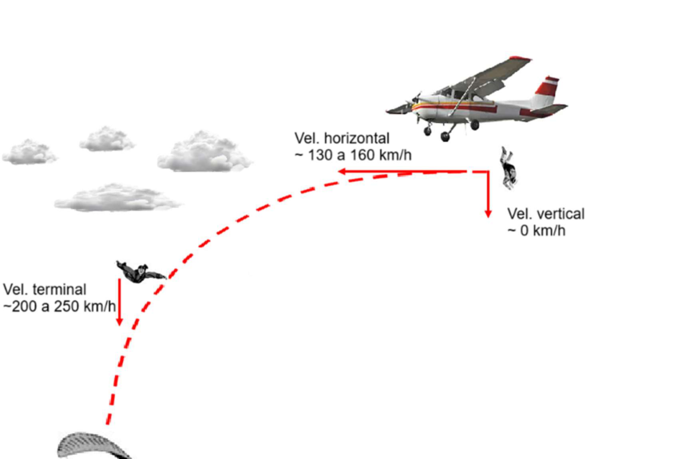

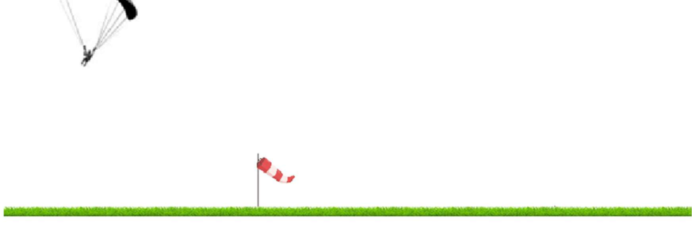

**Ilustración 16** – Velocidades en caída libre. Fuente: elaboración propia.

#### POSICIÓN DEL CUERPO

La postura más estable para un cuerpo humano en caída libre se conoce con el nombre de “ _box position_ ” o simplemente “rana” ( **Ilustración 17** ).

Al principio los paracaidistas aprenden a caer boca abajo, dándole el pecho al viento ( _Belly_ ). Caer boca abajo (Belly) resulta en una apertura más confiable que dando la espalda al flujo del aire. Al salir del avión el flujo viene de frente, arquear la espalda y estirar un poco las piernas da como resultado un mejor control de la caída, relajar el resto del cuerpo hace que la caída sea suave y sin movimientos.

---

<!-- Página 33 del PDF -->

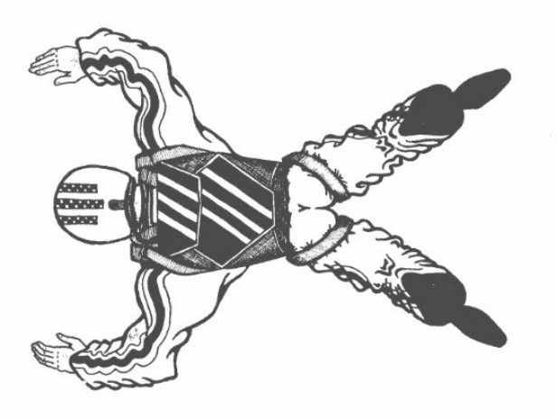

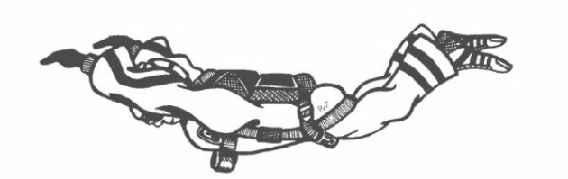

**Ilustración 17 -** Posición ideal del cuerpo en caída libre (“box position” o “rana”). Fuente: modificado de Body Flying (1979).8

Para lograr la postura ideal se recomienda (USPA. 2022):

   - a. Caderas hacia adelante.

   - b. Rodillas al ancho de los hombros.

   - c. Piernas ligeramente extendidas, rodillas flexionadas 45°, pies extendidos.

   - d. Brazos a 90° del cuerpo y relajados.

   - e. Codos flexionados 90° hacia adelante y relajados.

   - f. Cabeza arriba.

   - g. Practicarlo hasta hacerlo de manera natural.

- 8 Howerski, D.L. (1979). Body Flying. 1st edition, Paraski. 194 pp.

---

<!-- Página 34 del PDF -->

## MÓDULO III
---

<!-- Página 35 del PDF -->

### 7. APERTURA DEL PARACAIDAS

En los primeros dos (2) saltos, el alumno solamente tiene que salir de la aeronave (Ilustración 14).

- Al salir del avión, manténgase arqueado estable y con los hombros a nivel durante el despliegue, contando hasta cinco por miles.

- Mire por encima de su hombro para ver el pilotillo (si se usa) y el despliegue o apertura completa del paracaídas principal.

A partir del tercer salto, el alumno es responsable de realizar el procedimiento de apertura de su paracaídas. Por esta razón, es sumamente importante repasar todos los movimientos para crear una memoria muscular de dichos procedimientos (postura estable, wave-off, lanzamiento del pilotín, y procedimiento de emergencia).

A partir del tercer salto, el procedimiento de apertura debe ser realizado de la siguiente manera:

- Posición box o rana estable. en caso que el alumno no logre estabilizar deberá proceder con la apertura de manera inmediata.

- Señalización con ambas manos ( _wave off_ ) indicando que se realizará el procedimiento de apertura.

- Llevar la mano derecha hasta el pilotín, tirar del pilotín y lanzarlo hacia la derecha alejando la mano del cuerpo. Si por algún motivo el paracaidista no encuentra el pilotín, llevar la mano hacia la pierna derecha y deslizarla hacia arriba hasta llegar al contenedor y luego al pilotín. Si el paracaidista aún no logra encontrar el pilotín debe realizar el procedimiento de emergencia inmediatamente (ver Sección 8).

REVISIONES / CHECKS

1. SUSTENTACIÓN

Luego de lanzar el pilotín, el paracaidista debe verificar que la cúpula principal esté abierta y generando sustentación. Si han pasado más de tres (3) segundos de tiempo, la cúpula aún no genera sustentación y el paracaidista continua en caída libre, este debe realizar el procedimiento de emergencia (ver Sección 8).

---

<!-- Página 36 del PDF -->

#### 2. CHECK VISUAL Y FUNCIONAL

Una vez que la cúpula principal está abierta, se debe realizar una evaluación. La **evaluación de cúpula** consiste en una **inspección visual** seguida de una **prueba de funcionalidad** de los controles o "verificación de direccionamiento". El proceso de inspección se conoce como procedimiento de las **"Tres S´s"** . El objetivo final de las "Tres S´s" es determinar si has tenido una apertura normal, que la cúpula tenga una forma “rectangular” y que seas capaz de controlar el paracaídas. La cúpula debe poder girarse y frenarse ( _flare_ ) para un aterrizaje exitoso.

Las **"Tres S"** son una lista de prioridades de inspección: **Shape, Stable, Steerable**

1. Forma ( _<u>Shape):</u>_

   - Una verificación visual rápida debe mostrar una cúpula de **forma rectangular** , con **líneas rectas** , el **_slider_ (separador de líneas) abajo** y al alcance.

2. Estabilidad ( _<u>Stable</u>_ <u>):</u>

   - La cúpula debe volar **en línea recta** , sin más que un giro lento (si lo hubiera), no debe haber giros sin control y, todas las celdas deben de estar infladas.

3. Direccionamiento ( _<u>Steerable</u>_ <u>):</u>

   - Prueba de controles de vuelo:

      1. Jala las _toggles_ (manijas de control) hacia abajo hasta su extensión completa y mantén durante 2-3 segundos, luego regrésalas suavemente a la posición de vuelo completo.

      2. Mira a la derecha y realiza un giro de 90° hacia la derecha. Asegúrate de que no hay otro paracaidista al costado en la dirección del giro.

      3. Mira a la izquierda y realiza un giro de 90° hacia la izquierda. Asegúrate de que no hay otro paracaidista al costado en la dirección del giro.

Una vez que hayas completado la prueba de controles de vuelo y realizado un par de giros para asegurarte de que la cúpula es direccionable, puedes considerar oficialmente que la **evaluación visual y funcional** está completa.

Este proceso garantiza que el paracaídas esté en buenas condiciones y sea seguro para volar y aterrizar. **¡La seguridad es primero!** 🪂

---

<!-- Página 37 del PDF -->

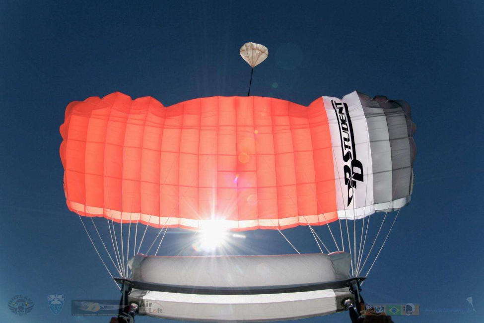

**Ilustración 18 -** Cúpula abierta completamente. Check visual: OK.

Fuente: Performance Designs Website.9

- 9 Disponible en: https://www.performancedesigns.com/. Último acceso: 15/07/2024

---

<!-- Página 38 del PDF -->

### 8. PROCEDIMIENTO DE EMERGENCIA

La _US Parachute Association_ (USPA, 2022) establece:

**“Decidir liberar o aterrizar la cúpula antes de 2,500 pies y actuar.”**

- Por lo tanto, la altura mínima de decisión es **2,500 pies** . Debajo de esta altura no es seguro desconectar la cúpula principal. Hay dos maneras de ejecutar el procedimiento de emergencia (P.E.) para liberar la cúpula principal y abrir la reserva. La **Ilustración 19** muestra el proceso de liberación y despliegue de la reserva de un paracaídas. Hay dos métodos para realizar el P.E.:

   - a) **Método A** : procedimiento con una mano en cada almohadilla o gancho (Ilustración 20). Algunos equipos tienen almohadilla en lugar de gancho.

   - b) **Método B** : procedimiento con ambas manos en cada almohadilla o gancho (Ilustración 21).

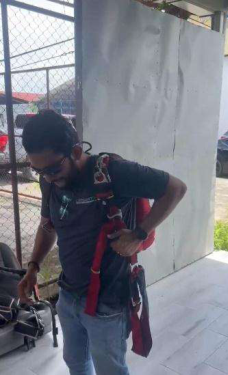

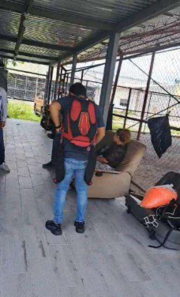

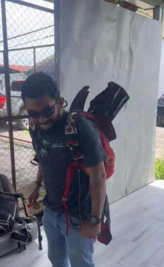

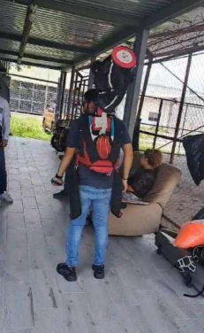

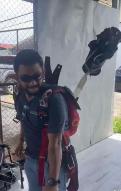

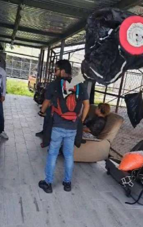

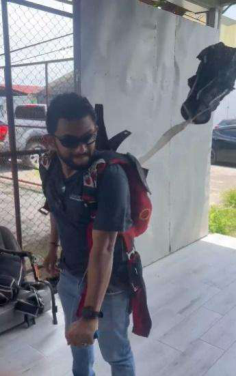

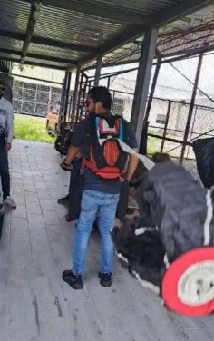

**Ilustración 19** – Proceso de liberación de la cúpula de reserva. Fuente: archivo personal.

---

<!-- Página 39 del PDF -->

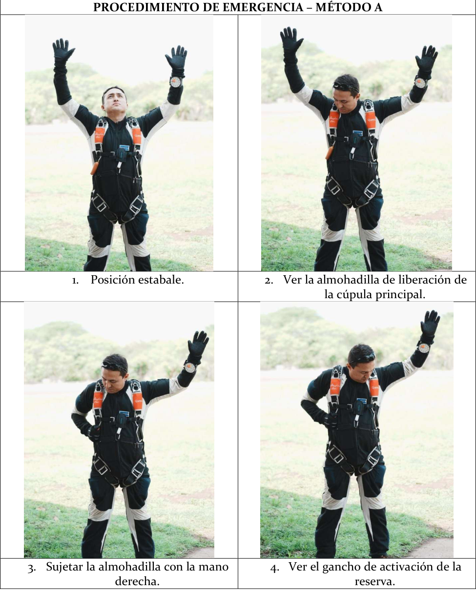

PROCEDIMIENTO DE EMERGENCIA – MÉTODO A

1. Posición estabale. 2. Ver la almohadilla de liberación de la cúpula principal.

3. Sujetar la almohadilla con la mano derecha.

4. Ver el gancho de activación de la reserva.

---

<!-- Página 40 del PDF -->

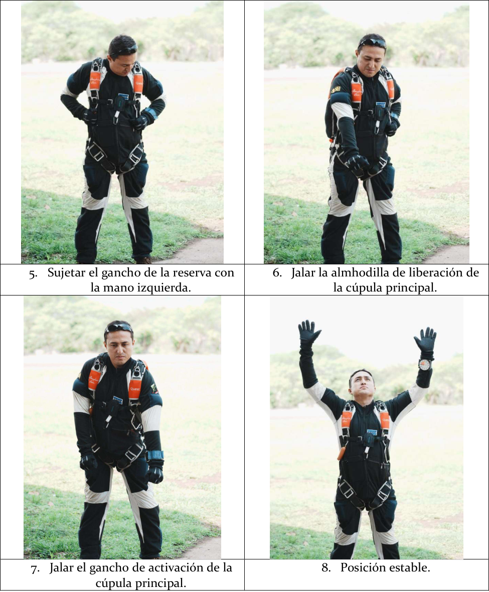

5. Sujetar el gancho de la reserva con la mano izquierda.

6. Jalar la almhodilla de liberación de la cúpula principal.

7. Jalar el gancho de activación de la cúpula principal.

8. Posición estable.

**Ilustración 20** – Procedimiento de emergencia: a) una mano cada gancho.

---

<!-- Página 41 del PDF -->

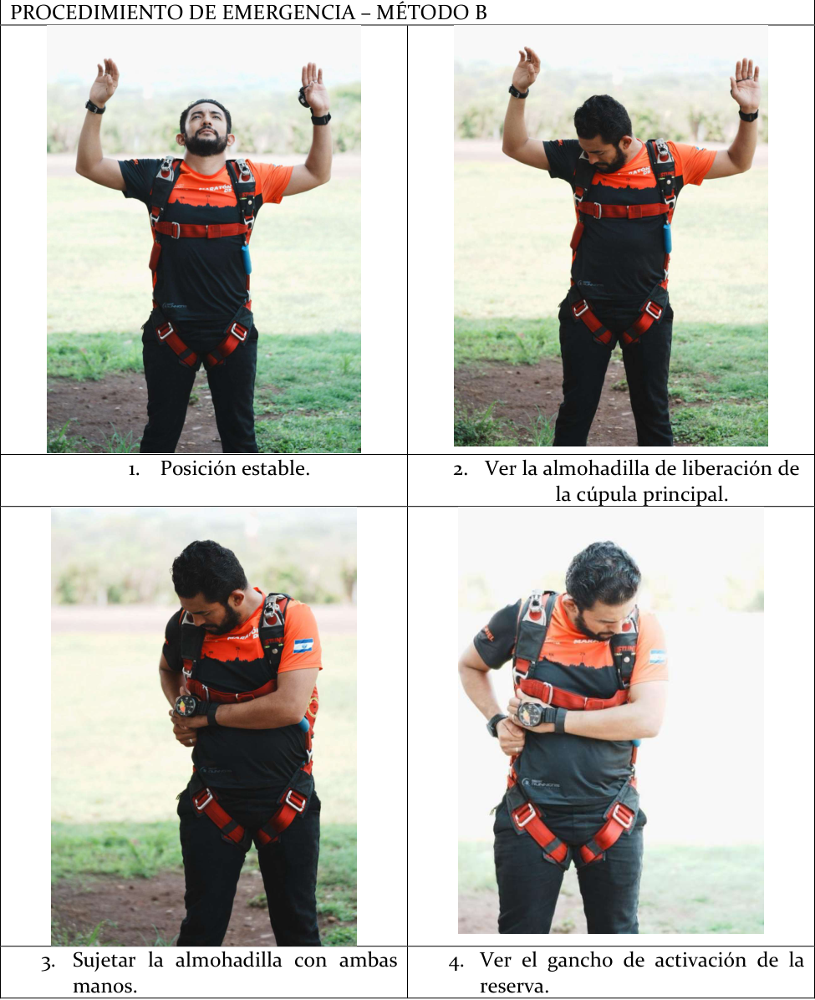

PROCEDIMIENTO DE EMERGENCIA – MÉTODO B

1. Posición estable. 2. Ver la almohadilla de liberación de la cúpula principal.

3. Sujetar la almohadilla con ambas manos.

4. Ver el gancho de activación de la reserva.

---

<!-- Página 42 del PDF -->

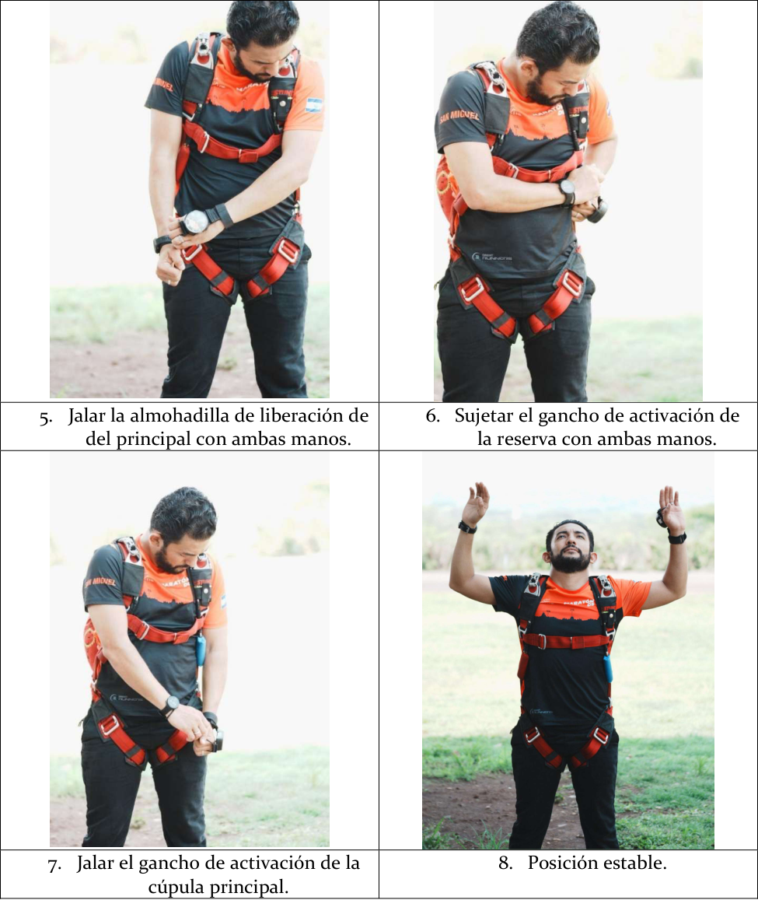

5. Jalar la almohadilla de liberación de del principal con ambas manos.

6. Sujetar el gancho de activación de la reserva con ambas manos.

7. Jalar el gancho de activación de la cúpula principal.

8. Posición estable.

**Ilustración 21** – Procedimiento de emergencia: a) una mano cada gancho.

---

<!-- Página 43 del PDF -->

### 9. ANORMALIDADES

1. DE ALTA VELOCIDAD

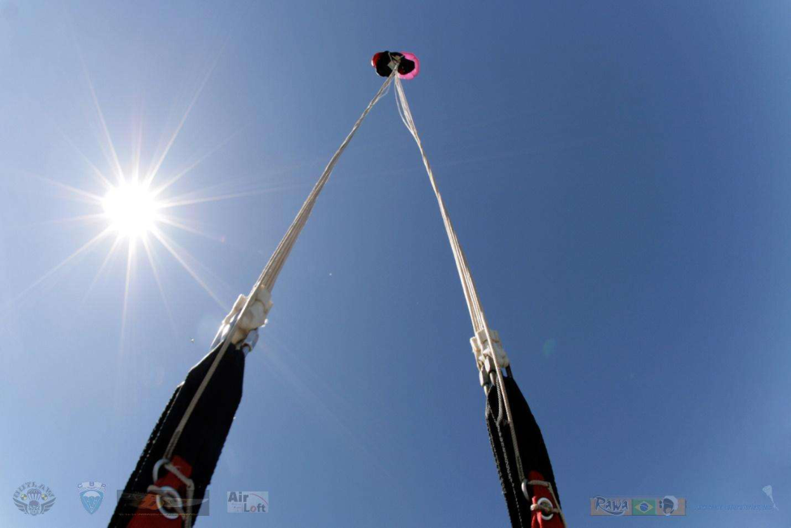

**Ilustración 22** – Anormalidad tipo “ _bag-lock_ ”. Fuente: _Performance Designs_ .10

**Situación:** el contenedor se abre y las líneas se estiran, pero la cúpula no sale de la bolsa de empaque.

**¿Qué hacer?:** procedimiento de emergencia inmediato. Tira de la almohadilla de liberación del principal y luego tira del gancho o almohadilla de apertura de la reserva a una altura no menor a 2,500 pies sobre el nivel del terreno.

> 10 Ídem

---

<!-- Página 44 del PDF -->

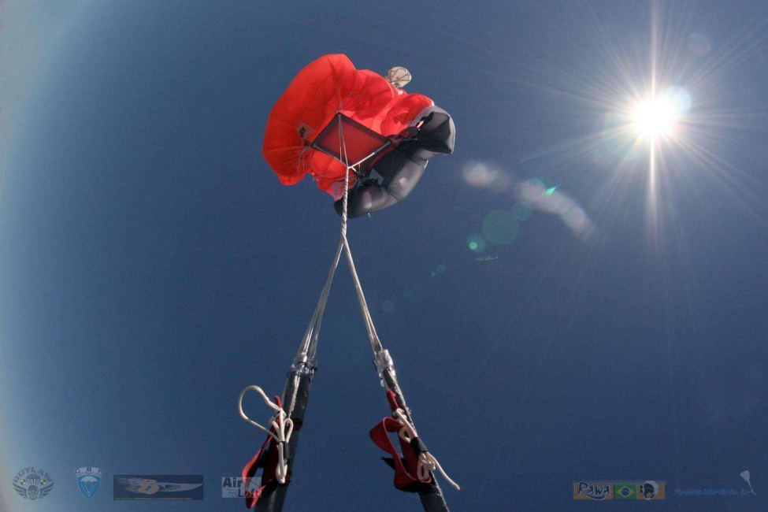

**Ilustración 23** - Anormalidad tipo "line twist" de alta velocidad. Fuente: Performance Designs.

**Situación:** lanzas el pilotín y luego notas que los elevadores ( _risers_ ) y/o líneas están enredados sobre tu cabeza. En algunos casos, comienzas a girar, y en cúpulas de desempeño medio ( _medium performance_ ), puedes entrar en un giro violento, probablemente con el separador ( _slider_ ) alto en las líneas.

#### ¿Qué hacer?:
- Si la cúpula se ha abierto normalmente sin giros, pero gira por sí sola, verifica que ambos frenos estén liberados. Es posible que una de las manecillas de los frenos ( _toggles_ ) se haya soltado durante la apertura.

- Si la cúpula está girando, en picada, y no estás orientado debajo de ella, jala la almohadilla de liberación del principal ( _cutaway_ ) y activa inmediatamente el paracaídas de reserva ( _reserve ripcord_ ) a no menos de 2,500 pies de altura.

---

<!-- Página 45 del PDF -->

#### 2. DE BAJA VELOCIDAD

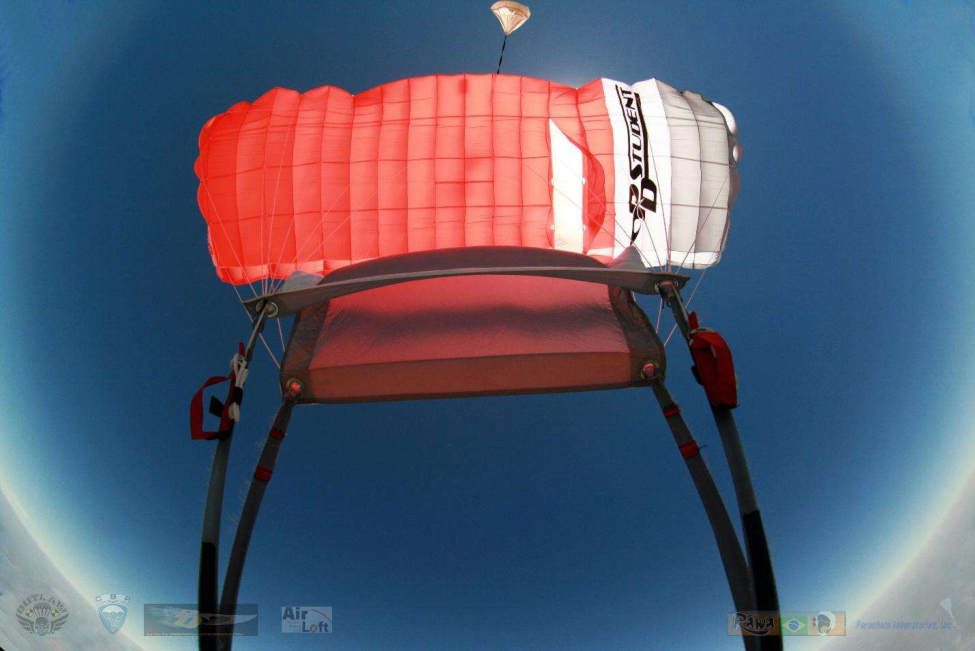

**Ilustración 24** - Anormalidad: tela rasgada. Fuente: Performance Designs.

**Situación:** hay un desgarre en la tela de la cúpula o cualquier otro daño similar.

**¿Qué hacer?:** sigue el proceso de evaluación estándar.

- ¿ESTABLE, RECTANGULAR Y DIRIGIBLE?

   - Evalúa el control y estabilidad al girar y frenar. Si una línea rota es de dirección, podrías optar por usar los arneses traseros para maniobrar y frenar (en lugar de cortar), dependiendo de tu experiencia y conocimiento de ese dosel en particular.

- Si hay un agujero en la cúpula lo suficientemente grande como para meter la cabeza, o si ves el cielo a través de cualquier perforación en la superficie inferior, libera el principal y abre la reserva (procedimiento de emergencia).

---

<!-- Página 46 del PDF -->

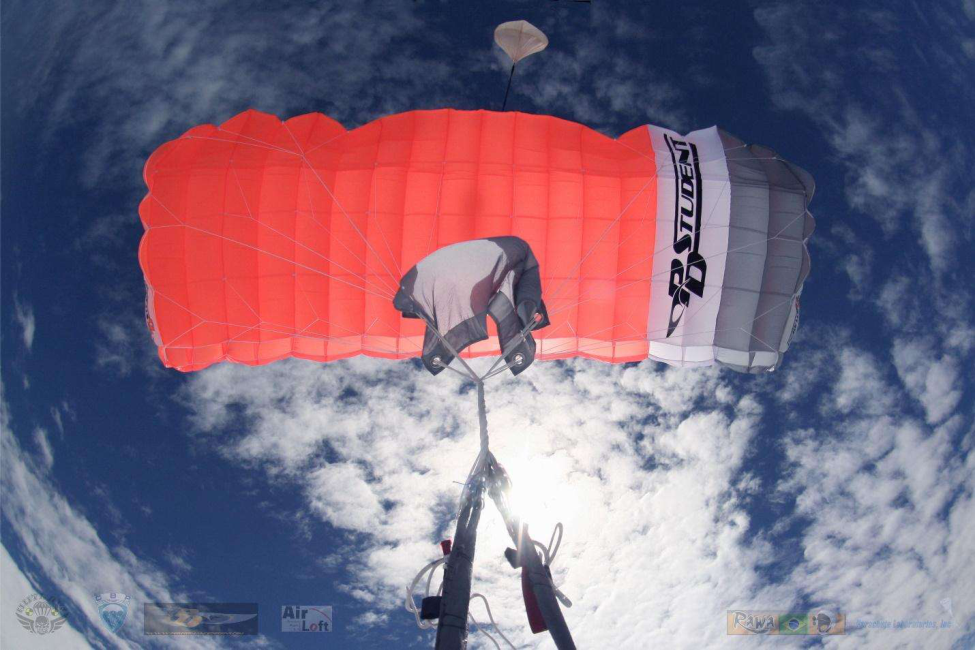

**Ilustración 25** - Anormalidad: "line twist". Fuente: Performance Designs.

**Situación:** lanzas el pilotín y luego notas que los elevadores ( _risers_ ) y/o líneas están enredados por torsión sobre tu cabeza. En algunos casos, comienzas a girar, y en cúpulas de desempeño medio ( _medium performance_ ), puedes entrar en un giro violento.

#### ¿Qué hacer?:
- Si la cúpula se ha abierto normalmente sin giros, pero gira por sí sola, verifica que ambos frenos estén liberados. Es posible que una de las manecillas de los frenos ( _toggles_ ) se haya soltado durante la apertura.

- Si la cúpula está centrada sobre tu cabeza, sin giros ni picadas, separa los elevadores ( _risers_ ) y patalea, como si estuvieras en un columpio, para girar en la dirección que desear desenredar los elevadores. También puedes juntar los elevadores y girar tu cuerpo debajo de la cúpula, como si estuvieras escurriendo algo. No dejes de monitorear tu altitud para calcular el tiempo disponible, teniendo siempre presente tu altitud de decisión (2,500 pies).

---

<!-- Página 47 del PDF -->

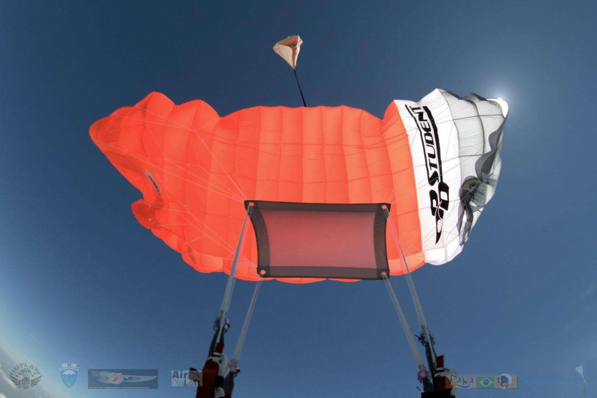

**Ilustración 22** - Anormalidad: cúpula inflada parcialmente, celdas laterales cerradas y slider al medio. Performance Designs.11

**¿Qué hacer?:** a principio esta anormalidad puede ser resuelta realizando el check funcional. Al realizar el _flare_ , las celdas que no estan infladas se deberían inflar.

11 Ídem

> 11 Ídem

---

<!-- Página 48 del PDF -->

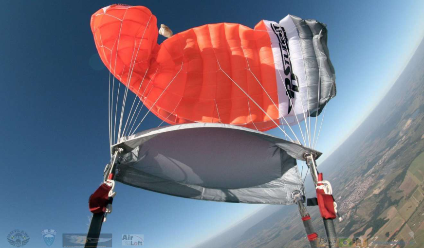

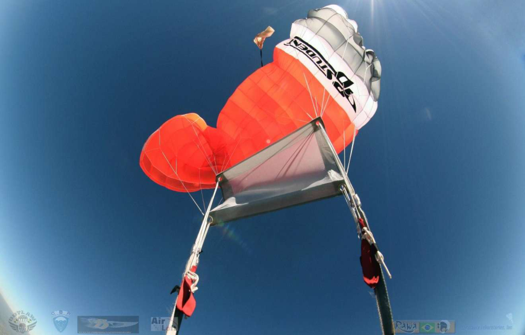

**Ilustración 26** - Anormalidad: "line-over". Performance Designs.

**¿Qué hacer?:** procedimiento de emergencia inmediato.

---

<!-- Página 49 del PDF -->

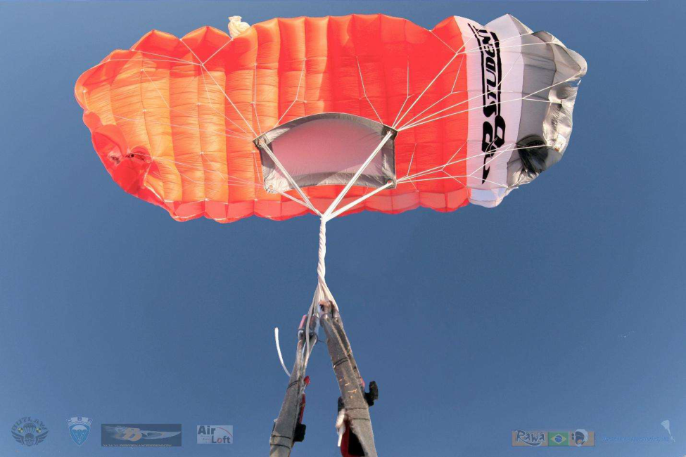

**Ilustración 27** - Anormalidad: combinada (en la ilustración hay 3 anormalidades combinadas). Performance Designs.12

**¿Qué hacer?:** procedimiento de emergencia inmediato.

12 Ídem

> 12 Ídem

---

<!-- Página 50 del PDF -->

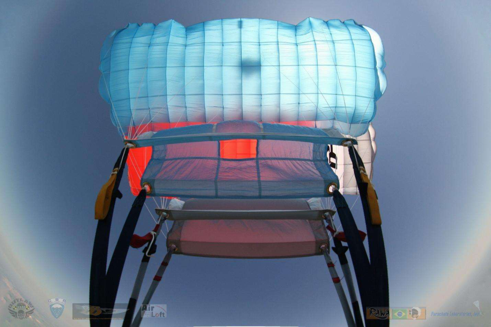

**Ilustración 28** - Anormalidad: biplano. Performance Designs.13

**Situación:** dos cúpulas abiertas, la principal y la reserva.

**¿Qué hacer?:** identificar la cúpula trasera y dejar los frenos guardados (sea la principal o la reserva). Dirige el dosel frontal suavemente usando los controles ( _toggles_ ) o deja los frenos guardados y gira tirando de los elevadores traseros ( _rear risers_ ). En el aterrizaje, realiza una caída de paracaidista ( _Parachute Landing Fall, PLF_ ).

> 13 Ídem

---

<!-- Página 51 del PDF -->

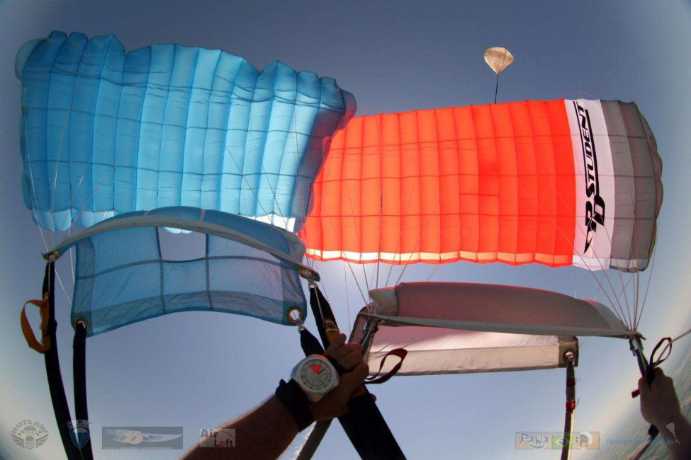

**Ilustración 29** - Anormalidad: lado-a-lado ( _side-by-side)_ . _Performance Designs_ .14

**Situación:** dos cúpulas abiertas, la principal y la reserva.

**¿Qué hacer?:** si las dos cúpulas no están enredadas y están claramente separadas, puedes optar por desconectar el principal ( _cut away_ ) y volar el dosel de reserva para un aterrizaje seguro. Sin embargo, si están en contacto, deja los frenos guardados en los elevadores de la cúpula de menor tamaño. Dirige la cúpula dominante (las más grande) suavemente usando los controles ( _toggles_ ) o deja los frenos guardados y gira tirando de los elevadores traseros ( _rear risers_ ). Realiza una caída de paracaidista ( _Parachute Landing Fall, PLF_ ) al aterrizar.

> 14 Ídem

---

<!-- Página 52 del PDF -->

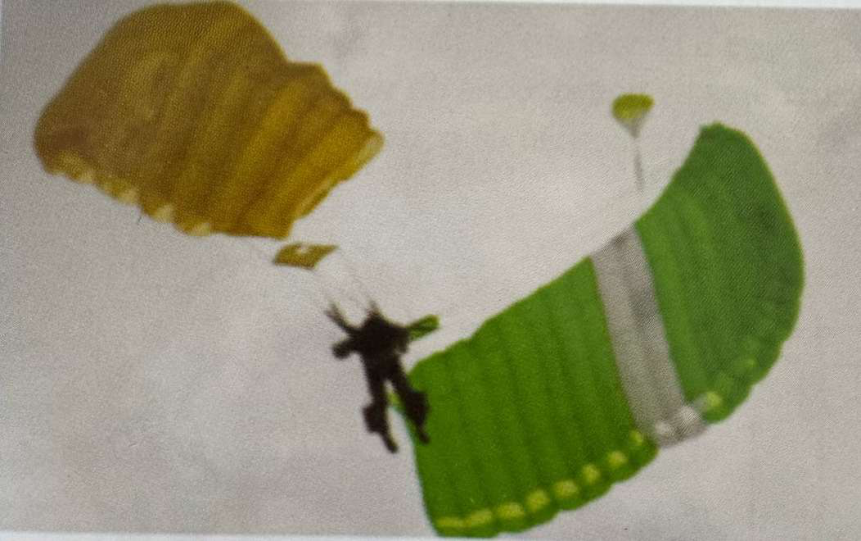

**Ilustración 30** - Anormalidad: _downplane_ . _Performance Designs_ .15

**Situación:** dos cúpulas abiertas, cada una abre hacia un lado y el paracaidista cae a alta velocidad (caída libre).

**¿Qué hacer?:** desconectar el RSL y jalar la almohadilla de liberación del principal.

> 15 Ídem

---

<!-- Página 53 del PDF -->

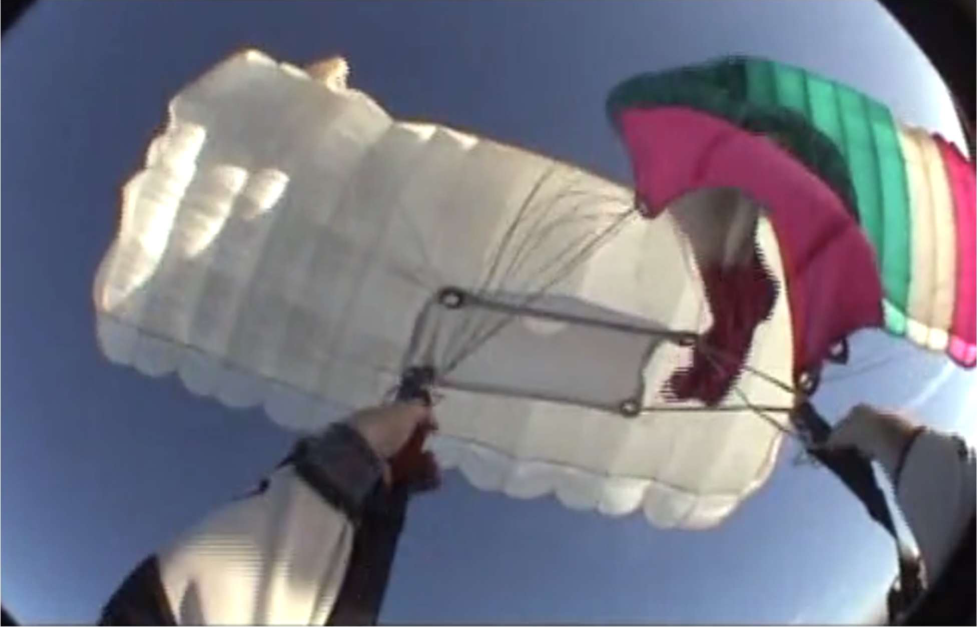

**Ilustración 31** - Anormalidad: entrelazados ( _entanglement_ ). _Performance Designs_ .16

**Situación:** dos cúpulas abiertas, una entrelazada con la otra.

**¿Qué hacer?:** intenta jalar y recoger la cúpula menos inflada si tienes tiempo y capacidad. Realiza una caída de paracaidista ( _Parachute Landing Fall_ , PLF) al aterrizar. La mejor recomendación es evitar esta situación compleja y peligrosa manteniendo tu equipo en buen estado, realizando revisiones técnicas, realizando reempaque de la reserva a cada seis meses, siendo consciente de la altitud, abriendo a tiempo, etc.

> 16 Ídem

---

<!-- Página 54 del PDF -->

**Ilustración 32** – Pilotín por debajo de la cúpula. _Performance Designs_ .17

**¿Qué hacer?:** proceder con el procedimiento estándar de revisión “estable, rectangular, dirigible”. Evaluar la estabilidad en giros y _flare_ .

17 Ídem

> 17 Ídem

---

<!-- Página 55 del PDF -->

**Ilustración 33** – Líneas enredadas. _Performance Designs_ .18

**Situación:** una o varias líneas están enredadas evitando el despliegue e inflado adecuado. **¿Qué hacer?:** realizar procedimiento de emergencia.

18 Ídem

> 18 Ídem

---

<!-- Página 56 del PDF -->

**Ilustración 34** – Una o varias líneas reventadas. _Performance Designs_ .19

**Situación:** una o varias líneas se han reventado. La cúpula podría estar estable o con giros fuertes.

**¿Qué hacer?:** realizar procedimiento de emergencia.

19 Ídem

> 19 Ídem

---

<!-- Página 57 del PDF -->

## MÓDULO IV
---

<!-- Página 58 del PDF -->

### 10.NAVEGACIÓN Y ATERRIZAJE

#### NAVEGACIÓN

El cono de viento y maniobrabilidad es una zona imaginaria definida por un cono trazado desde el punto de aterrizaje deseado para el área positiva, donde el paracaidista debe permanecer durante la navegación (zona de espera).

#### Procedimientos de vuelo normal en paracaídas (USPA, 2022):
- Después de chequear si tiene una buena cúpula, chequee su altura y, a continuación, mire directamente debajo de los pies y observe su posición sobre el suelo.

- Localice su área de espera objetivo y los "puntos de control" (ver Ilustraciones 35 y 36) donde comenzará cada parte de su patrón, y establezca una línea a su punto de entrada al patrón a los 1.000 pies según lo planificado.

- Divida la línea lógicamente de acuerdo con la altura restante (a mitad de camino de ida, a mitad de camino de regreso); por ejemplo, si está abierto a 4.000 pies, divida la línea por la mitad y permanezca sobre la primera mitad de la línea hasta 2.000 pies.

- Sobrevuele la mitad restante de la línea hasta llegar al punto de entrada del patrón preplanificado a 1.000 pies.

- Permanezca dentro del área de espera hasta 1.000 pies. Mientras esté en el área de espera y por encima de 1.000 pies, puede practicar giros y flare.

- Esté atento a otras cúpulas, controle su altura y compruebe su posición sobre el suelo periódicamente, especialmente después de cada giro o de la práctica del flare.

---

<!-- Página 59 del PDF -->

**Ilustración 35** – Concepto del Cono de Maniobrabilidad y navegación. Fuente: modificado de The Skydiver’s Handbook.20

> 20 Poynter, D.; Turoff, M. (2003). The Skydiver’s Handbook. Para Publishing, 402 pp., ISBN: 9781568600871.

---

<!-- Página 60 del PDF -->

**Ilustración 36** – Concepto del Cono de Viento para condiciones con y sin viento. Fuente: modificado de The Skydiver’s Handbook.21

> 21 Poynter, D.; Turoff, M. (2003). The Skydiver’s Handbook. Para Publishing, 402 pp., ISBN: 9781568600871.

---

<!-- Página 61 del PDF -->

#### ATERRIZAJE

#### Patrones de aterrizaje (USPA, 2022):
- Todo paracaidista es responsable de aterrizar de manera segura en un área despejada.

- En cada salto y antes de abordar se debe planear el patrón de aterrizaje utilizando una foto aérea, un diagrama, un mapa o una maqueta de la zona de salto.

- Determine la velocidad y dirección actual del viento.

- Localice el punto de aterrizaje y determine la línea de viento, que es una línea imaginaria que pasa por el punto de aterrizaje indicando la dirección del viento.

- Sí la cúpula se encuentra contra el viento del objetivo, este tenderá a empujarla hacia el objetivo (ver Ilustración 37).

- Sí la cúpula se encuentra a favor del viento del objetivo, este tenderá a alejarla del punto objetivo.

- En condiciones de no vientos, o vientos ligeros y variables, el alumno y el instructor deberán acordar una dirección de aterrizaje predeterminada y basar el patrón a utilizar en ese plan.

- Escoja un punto en tierra a favor del viento y en la línea de viento desde el que iniciara su aproximación final a 300 pies.

- Escoja el punto donde iniciara la Base a 600 pies. Determine el punto donde iniciará su patrón de aterrizaje a 1.000 pies (ver Ilustración 37 y 38).

- La ubicación y la forma del patrón de aterrizaje dependerán de la velocidad del viento. Con poco viento la forma y distancia de los puntos será similar a un cuadrado. Con vientos suaves el área posterior al punto de aterrizaje debe estar despejada y con espacio suficiente en caso de un mal cálculo.

- A medida que el viento es más fuerte la distancia de la aproximación final y el último giro son más cortas y la distancia con viento de cola es más larga.

- En condiciones de vientos fuertes es importante volar siempre en zonas despejadas siempre que se encuentre detrás del viento.

- Comience su patrón a 1.000 pies, volando a cada uno de los puntos de control que eligió en el suelo (ver Ilustración 37 y 38).

- Es posible que necesite comenzar su línea base gire a 600 pies incluso si no ha llegado al punto de control planificado.

- Si llega muy alto en el punto de control planificado de 600 pies, corrija haciendo una curva hacia afuera durante la línea base en el camino hacia el punto de 300 pies.

---

<!-- Página 62 del PDF -->

**lustración 37** – Patrón de aterrizaje. Fuente: USPA (2022).22

> 22 Disponible en:  https://www.uspa.org/sim Último acceso: 01/05/25

---

<!-- Página 63 del PDF -->

**Ilustración 38** – Patrón de aterrizaje. Fuente: skydivingtraining.org (2025).23

> 23 Disponible en: <u>https://skydivetraining.org/topic/flight-plan-and-landing-pattern/</u> Último acceso: 01/05/25

---

<!-- Página 64 del PDF -->

#### Aproximación final y aterrizaje (USPA, 2022):
- Una vez iniciada la aproximación final, la principal prioridad es mantener un vuelo recto hacia una zona abierta, libre de obstáculos.

- Pequeñas correcciones con los mandos se pueden utilizar para evitar obstáculos.

- Si la cúpula se desliza hacia los lados se deben efectuar las correcciones necesarias sobre los mandos para mantenerla volando recta hacia un área despejada.

- La mejor forma de evitar obstáculos es dirigir el paracaídas hacia un lugar libre para aterrizar en vez de focalizarse en el obstáculo.

- Si la cúpula está volando recto mantenga los mandos arriba en posición de full vuelo, lo que hará que se genere una mayor sustentación al momento de frenar.

- Es más fácil determinar la altura de frenado si se mantiene la vista hacia el horizonte y en vez de mirar el suelo entre los pies.

- Durante la aproximación final se deben tener piernas y rodillas juntas en posición para realizar una descomposición de caída o PFL (ver Ilustración 39).

- Justo antes de aterrizar convierta la velocidad horizontal en sustentación frenando al máximo ( _full flare_ ).

- Cuando se encuentre a dos veces su estatura sobre el suelo lleve los mandos hasta medio freno.

   - Lleve los mandos hasta abajo justo antes de tocar el piso ( _full flare_ ).

- La técnica de aterrizaje puede ser modificada por su instructor de acuerdo con paracaídas utilizado u otros factores.

- Si se inicia el frenado o flare muy alto, deje de frenar y mantenga los mandos donde los tenga.

- Si los mandos se llevan de nuevo arriba de manera abrupta causará que el paracaídas se clave de frente.

- Mantenga la vista al frente y la cúpula volando recta.

- Frene totalmente justo antes de llegar al piso.

- Los principiantes deben utilizar paracaídas grandes y dóciles que permita errores, estos paracaídas deben ser resistentes a un colapso ( _Stall)_ y simplemente mantener una velocidad lenta si el frenado o stall es alto. Siempre se debe estar preparado a descomponer la caída al momento de aterrizar.

- Aterrizar parado o caminando solo se debe intentar si se llega suave y está seguro de que podrá mantenerse en pie.

---

<!-- Página 65 del PDF -->

#### PFL: por sus siglás en inglés,** **_Parachute Landing Fall_ .

**Ilustración 39** – Procedimiento para realizar PFL. Fuente: skydivetraining.org (2025).24

#### Aterrizaje fuera de la zona
- Es preferible aterrizar en el área designada, la que normalmente está libre de obstáculos y es conocida, sin embargo, existen circunstancias que pueden hacerlo difícil o imposible:

- a. Errores de lanzamiento.

- b. Condiciones de viento inesperadas.

- c. Aperturas altas inadvertidas.

- d. Aperturas bajas, en especial en la reserva.

- Problemas resultantes de aperturas en situaciones no ideales pueden resultar en lesiones o fatalidades para estudiantes o paracaidistas experimentados:

- a. Giros bajos intencionales en zonas desconocidas.

- b. Giros no planeados para evitar obstáculos.

- c. Aterrizajes sobre o entre obstáculos o terrenos desnivelados.

> 24 Disponible en: <u>https://skydivetraining.org/topic/flight-plan-and-landing-pattern/</u> . Último acceso: 01/05/25

---

<!-- Página 66 del PDF -->

- d. Errores al tratar de regresar al patrón planeado o llegar muy bajo cuando había mejores opciones disponibles.

- Para evitar aterrizajes fuera de la zona:

- a. Conozca el punto de salida de acuerdo con las condiciones.

- b. Verifique el punto de salida en la puerta y de ser necesario solicite otra pasada.

- c. En caída libre, valide el punto de salida apenas salga y ajuste la altura de apertura si es necesario y es seguro de acuerdo con los siguientes criterios:

   - Otros grupos o individuos cerca en caída libre.

   - Paracaidistas desde otros aviones (Operaciones multi-aviones).

- Si no es posible evitar caer fuera de la zona:

- a. No pierda altura intentando regresar si hay alguna opción disponible.

- b. Decida una zona de aterrizaje de acuerdo con las condiciones de viento y su ubicación.

- c. Planea su patrón de descenso y aterrizaje a la zona alterna seleccionada.

- d. Verifique posibles riesgos en la zona alterna mientras tenga altura y tiempo para evitarlos:

   - Cuando valida si hay líneas eléctricas los postes y las torres son más fáciles de ubicar desde la altura.

   - Determine la dirección del viento para prevenir posibles turbulencias creadas por obstáculos o árboles y ajuste el patrón de aterrizaje.

      - Cercas y laderas son difíciles de detectar desde la altura.

   - Cercas y líneas eléctricas normalmente forman líneas rectas en el suelo.

#### Edificios y otros obstáculos
- Prepare su aproximación de aterrizaje para no estar cerca a ningún objeto.

- - Vuele lo suficientemente lejos de obstáculos para evitar que Ud. u otros paracaidistas se vean forzados a aterrizar en edificios u otros obstáculos peligrosos.

   - Enfóquese en áreas libres y diríjase a esas áreas.

- Realice giros planos a baja altura para evitar los obstáculos y prepárese a frenar totalmente y aterrizar.

- Si el aterrizaje sobre un edificio o cualquier otro obstáculo es inminente prepárese para PLF.

- Frene a 3 metros del primer punto de contacto con el obstáculo.

- Reciba el obstáculo con las piernas si aterriza sobre o de frente al edificio u obstáculo.

- Después de aterrizar sobre un objeto en condiciones con viento:

---

<!-- Página 67 del PDF -->

Desactive el RSL (si es posible) y libere el principal. Si aterriza en la reserva, intente contenerla mientras se quita el arnés. Espere por ayuda competente.

#### Giros bajos
Giros bajos es la principal causa de lesiones y muertes en el paracaidismo. Un giro bajo puede ser intencional o el resultado de un error de juicio o experiencia ante alguna situación. Para evitar giros bajos vuele hacia un área larga y despejada libre de obstáculos y vuele un patrón planeado que permita un tráfico cooperativo. Si aterriza fuera del área realice un patrón iniciando a 1.000 pies. Al detectar que se inició el giro a una altura insegura:

- a. Utilice los mandos para que la cúpula este arriba nuevamente y se detenga el giro.

- b. Finalice la caída.

- c. Prepárese para PLF.

- d. Maneje la velocidad inducida para el giro: espere más control de velocidad utilizando y respuesta al utilizar los mandos. Espere un planeo más plano y largo de lo normal.

- e. En caso de llegar al piso prematuramente sin importar que tan fuerte sea, siga volando la cúpula para reducir la lesión.

### 11. PROGRESIÓN EN EL DEPORTE

BUENAS PRÁCTICAS PARA PROGRESAR CON SEGURIDAD EN EL DEPORTE

BRIEFING

n el contexto del **paracaidismo** , el término **_briefing_** se refiere a una **reunión informativa** o **sesión de instrucción** que se lleva a cabo antes de realizar un salto. Es una parte esencial del proceso de preparación, ya que garantiza que todos los participantes estén al tanto de los detalles, procedimientos y medidas de seguridad necesarias para realizar el salto de manera segura y efectiva.

---

<!-- Página 68 del PDF -->

¿Qué se incluye en un briefing de paracaidismo?

1. Información sobre el salto:

   - Tipo de salto (solo, en grupo, en formación, etc.).

   - Altitud de salto.

   - Objetivos del salto (por ejemplo, entrenamiento, práctica de maniobras, salto recreativo).

2. Procedimientos de seguridad:

   - Revisión del equipo (paracaídas principal, reserva, altímetro, casco, etc.).

   - Verificación de los puntos de seguridad (checks) antes del salto.

   - Qué hacer en caso de emergencia (por ejemplo, cómo actuar si el paracaídas principal no se abre correctamente).

3. Plan de vuelo:

   - Posición del cuerpo durante la caída libre.

   - Señales manuales y comunicación durante el salto.

   - Técnicas de apertura del paracaídas.

   - Dirección y zona de aterrizaje.

4. Roles y responsabilidades:

   - Si es un salto en grupo, se asignan roles específicos a cada participante.

   - En saltos de formación, se explica la secuencia de maniobras y cómo mantener la posición correcta.

5. Condiciones climáticas y del entorno:

   - Información sobre el viento, nubosidad y otras condiciones meteorológicas.

   - Identificación de posibles riesgos en la zona de salto o aterrizaje.

6. Preguntas y aclaraciones:

   - Los participantes pueden hacer preguntas para resolver dudas antes del salto.

Importancia del _briefing_ en paracaidismo:

- **Seguridad** : Es fundamental para minimizar riesgos y asegurar que todos los participantes estén preparados.

- **Coordinación** : Facilita la comunicación y sincronización entre los paracaidistas, especialmente en saltos grupales.

- **Confianza** : Brinda tranquilidad a los participantes, especialmente a los principiantes, al saber que están bien informados y preparados.

El **briefing** es una parte crucial del paracaidismo que asegura que cada salto se realice de manera organizada, segura y eficiente.

**¡Nunca se salta sin un buen briefing!** 🪂

---

<!-- Página 69 del PDF -->

#### DEBRIEFING
En el contexto del **paracaidismo** , el **debriefing** es una **reunión o sesión de evaluación** que tiene lugar **después de realizar un salto** . A diferencia del **_briefing_** , que se realiza antes del salto para preparar a los participantes, el _debriefing_ se enfoca en analizar lo ocurrido durante el salto, identificar aciertos, errores y áreas de mejora, con el objetivo de aprender y mejorar para futuros saltos.

¿Qué se incluye en un debriefing de paracaidismo?

1. Revisión del salto:

   - Análisis de cómo se desarrolló el salto en general.

   - Evaluación de si se cumplieron los objetivos planteados (por ejemplo, formación en el aire, prácticas específicas, etc.).

2. Desempeño individual y grupal:

   - Comentarios sobre la técnica, posición del cuerpo y manejo durante la caída libre.

   - Evaluación de la apertura del paracaídas y el vuelo bajo el dosel.

   - En saltos grupales, se revisa la coordinación y comunicación entre los participantes.

3. Identificación de errores y áreas de mejora:

   - Señalar cualquier fallo o situación que haya ocurrido durante el salto.

   - Discutir cómo se podrían evitar esos errores en el futuro.

4. Reconocimiento de aciertos:

   - Destacar lo que se hizo bien para reforzar las buenas prácticas.

5. _Feedback_ constructivo:

   - Los instructores o compañeros brindan retroalimentación de manera respetuosa y útil.

   - Se fomenta un ambiente de aprendizaje y mejora continua.

6. Recomendaciones para futuros saltos:

   - Sugerencias para mejorar la técnica, la seguridad o la coordinación.

   - Planificación de próximos saltos con base en lo aprendido.

7. Aspectos de seguridad:

   - Revisión de cualquier incidente o situación de riesgo que haya ocurrido.

   - Refuerzo de los protocolos de seguridad para evitar problemas en el futuro.

---

<!-- Página 70 del PDF -->

Importancia del _debriefing_ en paracaidismo:

- **Aprendizaje** : Permite a los paracaidistas aprender de sus experiencias y mejorar sus habilidades.

- **Seguridad** : Ayuda a identificar y corregir errores que podrían poner en riesgo la seguridad en futuros saltos.

- **Motivación** : Reconoce los logros y avances, lo que motiva a los participantes a seguir practicando y mejorando.

- **Comunicación** : Fomenta la comunicación abierta y el trabajo en equipo, especialmente en saltos grupales.

Ejemplo de un debriefing:

- **Instructor** : "Durante el salto, la formación inicial fue buena, pero noté que en la segunda parte hubo descoordinación. ¿Qué creen que pasó?"

- **Paracaidista 1** : "Creo que no mantuve la posición correcta al girar y me desestabilicé."

- **Instructor** : "Exacto. Para la próxima, enfócate en mantener los brazos y piernas firmes. Por otro lado, la apertura del paracaídas fue impecable. ¡Buen trabajo!"

En resumen, el **_debriefing_** es una herramienta esencial en el paracaidismo para asegurar que cada salto sea una oportunidad de aprendizaje y mejora continua.

**¡Nunca se subestima el poder de un buen** **_debriefing_ !** 🪂

¿CÓMO SELECCIONAR EL TAMAÑO ADECUADO DE TU CÚPULA?

El fabricante de cúpulas publica la carga alar o el peso recomendado para cada modelo de paracaídas. Esta información y otros datos adicionales relevantes pueden ser revisados en el manual del propietario o en la página web del fabricante.

El desempeño del paracaídas cambia con la carga alar. Con una **carga alar alta (>1.0)** espere: más velocidad hacia adelante, una tasa de descenso más rápida, giros más rápidos, una clavada más larga y pronunciada después de un giro, fallas más violentas, y se requiere más habilidad para frenar correctamente. Con una **carga alar baja (<1.0)** espere menos penetración en vientos fuertes, giros más lentos perdona más los errores al aterrizar y menos predecible en turbulencia.

---

<!-- Página 71 del PDF -->

La USPA establece las siguientes directrices para la carga alar máxima según la categoría o experiencia del paracaidista:

- a) Alumnos: máximo **0.8** libras por pie cuadrado (lb/pie2 ).

- b) Licencias A y B: máximo **1.0** libras por pie cuadrado (lb/pie2 )

- c) c. Licencia C: máximo **1.2** libras por pie cuadrado (lb/pie2 )

- d) Licencia D: máximo 1.4 libras por pie cuadrado (lb/pie2 )

- e) Los paracaidistas deben recibir un entrenamiento formal en manejo de cúpula.

- f) Cualquier paracaídas de 150 pies o menos es considerado de alto desempeño.

CATEGORIAS - LICENCIAS USPA

La **_United States Parachute Association_ (USPA)** , que es la organización líder en paracaidismo en Los Estados Unidos, establece un sistema de **licencias** y **categorías** para los paracaidistas. Estas licencias indican el nivel de experiencia, habilidades y conocimientos de un paracaidista, y permiten acceder a diferentes tipos de saltos y actividades dentro del deporte. A continuación, te detallo las licencias de paracaidismo según la USPA:

#### 1. Licencia A (Licencia de Paracaidista Básico)

   - Requisitos:

      - Completar al menos **25 saltos** .

      - Aprobar los exámenes teóricos de la USPA.

      - Demostrar habilidades básicas de caída libre, control del cuerpo, apertura del paracaídas y aterrizaje seguro.

   - Privilegios:

      - Saltar sin supervisión directa de un instructor.

      - Empacar su propio paracaídas (solamente cúpula principal)

      - Saltar con otros paracaidistas licenciados.

      - Realizar saltos en condiciones climáticas y de ubicación aprobadas.

2. Licencia B (Licencia de Paracaidista Intermedio)

   - Requisitos:

      - Completar al menos **50 saltos** .

      - Tener un mínimo de 30 minutos de tiempo acumulado en caída libre.

---

<!-- Página 72 del PDF -->

- Demostrar habilidades avanzadas, como giros, desplazamientos y formación básica en el aire.

      - Aprobar un examen teórico más avanzado.

   - Privilegios:

      - Participar en saltos grupales más complejos.

      - Realizar saltos nocturnos (con entrenamiento adicional).

      - Con 100 saltos son elegibles para realizar la calificación de _coach_ USPA.

3. Licencia C (Licencia de Paracaidista Avanzado)

   - Requisitos:

      - Completar al menos **200 saltos** .

      - Tener un mínimo de 60 minutos de tiempo acumulado en caída libre.

      - Demostrar habilidades avanzadas, como formación en el aire, vuelo relativo y maniobras bajo el dosel.

      - Aprobar un examen teórico avanzado.

   - Privilegios:

      - Participar en saltos de exhibición (con autorización adicional).

      - Saltar con cámaras (para grabación).

      - Realizar saltos en formaciones grandes ( _big-ways_ ).

      - Elegible para realizar entrenamiento de _wingsuit_

4. Licencia D (Licencia de Paracaidista Experto)

   - Requisitos:

      - Completar al menos **500 saltos** .

      - Tener un mínimo de 180 minutos de tiempo acumulado en caída libre.

      - Demostrar habilidades excepcionales en caída libre y vuelo bajo el dosel.

      - `o` Aprobar un examen teórico avanzado.

   - Privilegios:

      - Actuar como instructor asistente (con certificación adicional).

      - Participar en saltos de alto rendimiento y competiciones.

      - Realizar saltos en condiciones más desafiantes (con autorización).

Progresión de las Licencias:

- Las licencias se obtienen de manera progresiva, comenzando con la **Licencia A** y avanzando hasta la **Licencia D** .

---

<!-- Página 73 del PDF -->

- Cada licencia requiere un número mínimo de saltos, horas de caída libre y la aprobación de exámenes teóricos y prácticos.

- Las licencias permiten a los paracaidistas acceder a nuevas oportunidades y responsabilidades dentro del deporte.

**Tabla 1 -** Resumen de Licencias USPA:

|Licencia|Saltos Mínimos|Tiempo en Caída Libre|Privilegios|
|---|---|---|---|
|A|25|-|Saltos básicos sin supervisión. Empacar su propio paracaídas.|
|B|50|30 minutos|Saltos grupales, salto de globo y helicóptero|
|C|200|60 minutos|Saltos de exhibición, formaciones grandes, uso de cámaras de video.|
|D|500|180 minutos|Instructor asistente, competiciones.|

Este sistema de licencias garantiza que los paracaidistas desarrollen las habilidades y conocimientos necesarios para practicar el deporte de manera segura y responsable.

**¡Cada licencia es un paso hacia nuevas aventuras en el cielo!** 🪂

OTRAS CERTIFICACIONES Y ESPECIALIDADES

Además de las licencias básicas, la USPA ofrece **certificaciones adicionales** para actividades especializadas, como:

1. Instructor de Paracaidismo:

   - Certificación para enseñar a nuevos paracaidistas.

   - Requiere experiencia avanzada y aprobación de cursos específicos.

2. Wingsuit Flying (Vuelo con Traje Ardilla):

---

<!-- Página 74 del PDF -->

- Certificación para usar trajes de alas ( _wingsuits_ ).

   - Requiere un mínimo de 200 saltos y entrenamiento especializado.

3. Freefly (Estilo Libre):

   - Certificación para realizar maniobras avanzadas en caída libre, como volar de cabeza o en posición sentada.

4. Canopy Piloting (Piloto de Dosel):

   - Certificación para realizar maniobras avanzadas bajo el dosel, como giros cerrados y aterrizajes de precisión.

5. Saltos Nocturnos:

   - Certificación para realizar saltos durante la noche.

   - Requiere entrenamiento adicional y experiencia previa.

---

<!-- Página 75 del PDF -->

### 12.GLOSARIO DE TÉRMINOS Y SIGLAS

Para facilitar la comprensión de instrucciones y la comunicación alumnos, instructores y atletas, es importante tener conocimiento de los siguientes términos y siglas utilizadas en el deporte del paracaidismo:

|AAD|Dispositivo de Apertura Automática (por sus siglas en inglés, Automatic Activation Device)|
|---|---|
|AFF|Accelerated Free Fall|
|Wing suit|Traje de ardilla utilizado en la modalidad “_wing suiting_”|
|Briefing|Reunión Informativa antes del salto|
|Debriefing|Reunión Informativa después del salto|
|FAI|Federación Aeronáutica Internacional (en francés,_Fédération_ _Aéronautique Internationale_)|
|PLF|Parachute Landing Fall|
|RSL|Línea estática de la reserva_(Reserve static line)_|
|USPA|US Parachute Association|
|Wave-off|Acción de señalizar cuando el salto en caída libre a finalizado, se cruza los brazos y se agitan indicando la apertura del principal|
|Wing load|Carga alar|

---

<!-- Página 76 del PDF -->

#### RECURSOS ADICIONALES

US Parachute Associations`s website (USPA): <u>https://www.uspa.org/</u> British Skydiving Association: <u>https://britishskydiving.org/</u> Australian Parachute Federation: <u>https://www.apf.com.au/</u> Skydivemagazine: <u>https://www.skydivemag.com/new/</u> Revista Parachutist: <u>https://parachutist.com/</u> Chutingstar (accesórios paracaidismo): <u>https://www.chutingstar.com/</u>

---

<!-- Página 77 del PDF -->

--- ÚLTIMA PÁGINA ---

---

<!-- Página 78 del PDF -->

